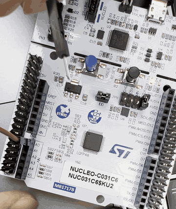
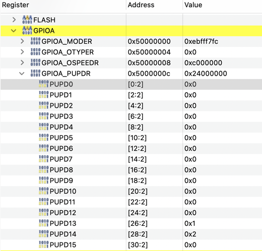
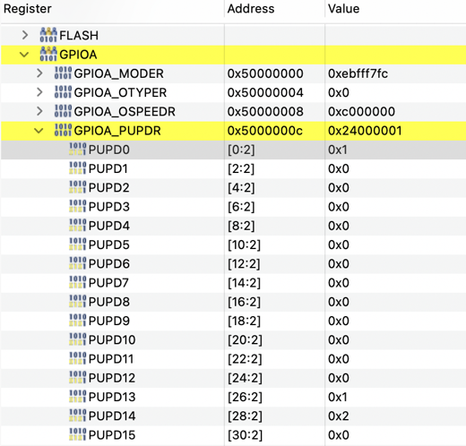
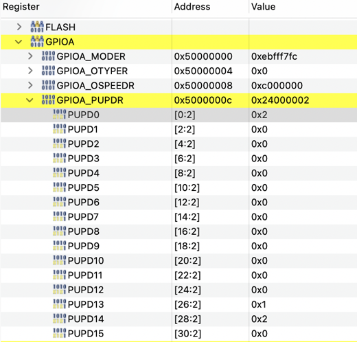

# 기초 02. 플로팅 입력 실험

> A0(PA0)를 아무 데도 연결하지 않은 입력으로 두고, 칩 내부의 풀업·풀다운을 **PUPDR 레지스터로 직접 바꿔 가며** 입력 값이 어떻게 달라지는지 LD4로 관찰한 실험

관련 개념 노트: [`docs/basics/02_digital_floating.md`](../../docs/basics/02_digital_floating.md)

## 🎯 목표
- 입력 핀이 어디에도 연결되지 않은 **플로팅** 상태를 직접 관찰하기
- 칩 내부 풀업·풀다운을 **PUPDR 레지스터**로 설정하고, 그에 따라 입력 값이 바뀌는 것 확인하기
- 점퍼선으로 입력 핀을 GND·3V3에 연결했을 때의 결과를 풀업·풀다운과 함께 이해하기

## 📌 사용한 핀 / 설정
- **MCU**: STM32C031C6T6 (MCU/MPU Selector로 생성)
- **풀업·풀다운 설정**: CubeMX에서는 No pull로 두고, 코드에서 `PULL_MODE` 값으로 PUPDR을 직접 설정

| 핀 | 모드 | 역할 |
| --- | --- | --- |
| PA0 | GPIO_Input | 실험할 입력 핀 (보드의 **A0**, CN8 1번) / User Label: `TEST_IN` |
| PA5 | GPIO_Output | 입력 값을 보여 주는 LED (LD4) / User Label: `LD4` |
| PA13 | SWDIO | 디버그 데이터 (Serial Wire) |
| PA14 | SWCLK | 디버그 클럭 (Serial Wire) |

## 💻 핵심 코드

### 풀업·풀다운 선택
```c
/* USER CODE BEGIN PD */
#define PULL_MODE 0   // 0: No pull(플로팅), 1: 풀업, 2: 풀다운
/* USER CODE END PD */
```

```c
/* USER CODE BEGIN 2 */
/* PA0의 풀업/풀다운을 PUPDR 레지스터로 직접 설정 */
GPIOA->PUPDR = (GPIOA->PUPDR & ~(3U << 0)) | ((uint32_t)PULL_MODE << 0);
/* USER CODE END 2 */
```
- PUPDR은 핀마다 **2비트**를 사용하며, PA0는 0~1번 비트다. (핀 n은 `n × 2`번 비트부터)

  | 비트 값 | 의미 |
  | :---: | --- |
  | `00` | 풀업·풀다운 없음 (플로팅) |
  | `01` | 풀업 |
  | `10` | 풀다운 |

- `& ~(3U << 0)`: `3U`는 이진수 `11`로, PA0의 두 비트만 0으로 지운다.
- `| (PULL_MODE << 0)`: 지운 자리에 새 값을 넣는다. `PULL_MODE`가 2이면 이진수 `10`(풀다운)이 들어간다.
- PUPDR 전체를 덮어쓰지 않고 PA0의 비트만 바꾸는 이유: 같은 레지스터에 **PA13(SWDIO)·PA14(SWCLK)의 풀업·풀다운 설정**이 들어 있어, 통째로 덮어쓰면 디버그 연결에 영향을 줄 수 있다.

### 입력 값을 LED로 표시
```c
/* USER CODE BEGIN 3 */
if (HAL_GPIO_ReadPin(TEST_IN_GPIO_Port, TEST_IN_Pin) == GPIO_PIN_SET) {
    HAL_GPIO_WritePin(LD4_GPIO_Port, LD4_Pin, GPIO_PIN_SET);     // 입력 1 → LED 켜짐
} else {
    HAL_GPIO_WritePin(LD4_GPIO_Port, LD4_Pin, GPIO_PIN_RESET);   // 입력 0 → LED 꺼짐
}
/* USER CODE END 3 */
```
- "버튼이 눌렸는지"가 아니라 **읽은 값을 그대로** LED로 보여 준다. (입력 1 → 켜짐, 0 → 꺼짐)

## 🎬 결과

### 실험 A: 플로팅 상태에서 점퍼선 끝을 손으로 잡았다 놓기


A0에 점퍼선을 꽂고 반대쪽 끝을 손으로 잡으면 LD4가 켜지고, 놓으면 꺼졌다. 연결이 정해지지 않은 입력 핀이 손(몸)이 모은 전기 잡음에 따라 값이 바뀌는 것을 확인했다.

### 실험 결과 정리
| 실험 | `PULL_MODE` (PUPDR) | 바깥 연결 | 관찰 결과 | 핀 값 |
| :---: | --- | --- | --- | :---: |
| A | 0 (`00`, 플로팅) | 점퍼선 끝을 손으로 잡았다 놓기 | 잡으면 켜지고 놓으면 꺼짐 | 정해지지 않음 |
| B | 1 (`01`, 풀업) | 점퍼선 끝을 손으로 잡았다 놓기 | 계속 켜짐 | 1 |
| C | 2 (`10`, 풀다운) | 점퍼선 끝을 손으로 잡았다 놓기 | 계속 꺼짐 | 0 |
| D | 1 (`01`, 풀업) | 점퍼선으로 A0 ↔ GND 연결 | 꺼짐 | 0 |
| E | 2 (`10`, 풀다운) | 점퍼선으로 A0 ↔ 3V3 연결 | 켜짐 | 1 |

### 디버거로 본 PUPDR (SFRs 창)
| `PULL_MODE 0` | `PULL_MODE 1` | `PULL_MODE 2` |
| :---: | :---: | :---: |
|  |  |  |
| `0x24000000` (PUPD0 = 0) | `0x24000001` (PUPD0 = 1) | `0x24000002` (PUPD0 = 2) |

- `PULL_MODE`에 따라 **PUPD0(맨 끝 2비트)만** 0 → 1 → 2로 바뀌었다.
- 앞쪽 `0x24...`는 `PUPD13 = 1`(PA13 풀업), `PUPD14 = 2`(PA14 풀다운)로, 디버그 핀의 기본 설정이 그대로 유지되었다. 마스크(`& ~(3U << 0)`)로 PA0 비트만 바꾼 덕분이다.

## 💡 배운 점
- **디지털 입력**: 칩은 핀의 전압을 보고 높으면 1, 낮으면 0으로 판단한다. 그 사이 전압은 어느 쪽으로 읽힐지 정해지지 않는다.
- **플로팅**: 입력 핀이 어디에도 연결되지 않으면 전압을 정해 주는 연결이 없어, 손이나 주변 잡음에 따라 값이 제멋대로 바뀐다.
- **칩 내부 풀업·풀다운**: GPIO 핀마다 칩 안에 "저항을 거쳐 3.3V에 연결하는 스위치(풀업)"와 "저항을 거쳐 GND에 연결하는 스위치(풀다운)"가 들어 있고, PUPDR로 어느 쪽을 연결할지 고른다. 그래서 바깥에 아무것도 연결하지 않아도 풀다운이면 0, 풀업이면 1이 읽힌다.
- **핀 값이 정해지는 이유**: 풀업만 연결하고 바깥이 열려 있으면 전류가 흐르지 않으므로, 저항이 맡는 전압도 0V(전압 = 전류 × 저항)다. 따라서 핀은 저항 반대편과 같은 3.3V가 되어 1로 읽힌다.
- **점퍼선으로 반대쪽에 연결하면**: 점퍼선은 저항이 거의 없어 핀을 GND(또는 3V3)에 바로 고정한다. 이때 전류가 저항을 지나 흐르고, 3.3V의 전압 차는 저항이 전부 맡는다. 실험 D(풀업 + GND 연결)는 **B1 버튼을 누른 것과 같은 회로**다.
- **점퍼선은 핀의 연장**: 끝이 아무 데도 연결되지 않은 점퍼선은 핀과 같은 전압이며, 이어진 길이 없으므로 전류는 흐르지 않는다.
- **레지스터 일부만 바꾸기**: 마스크로 필요한 비트만 지우고 새 값을 넣어야 같은 레지스터의 다른 설정(PA13·PA14)을 지킬 수 있다.
- **디버거 실행 방식**: Step Over는 누를 때마다 한 줄씩 실행하므로, 입력이 계속 변하는 실험은 Run(▶)으로 실행해야 변화를 실시간으로 볼 수 있다.
- **안전**: 점퍼선은 항상 A0에만 한쪽을 꽂고, 3V3와 GND를 직접 잇지 않는다(합선). 3.3V로 동작하는 칩이므로 5V 핀은 사용하지 않는다. 점퍼선 끝이 보드의 다른 부품 금속에 닿지 않게 한다.

## 🔍 트러블슈팅
자세한 내용은 [`docs/troubleshooting.md`](../../docs/troubleshooting.md)에 정리했습니다.

| 문제 | 원인 | 해결 |
| --- | --- | --- |
| 실험에 쓸 A0 핀이 보드 어디인지 몰랐음 | 보드에는 아두이노 이름(A0)으로 표기되어 칩 핀 이름(PA0)과 다르고, 보드 방향에 따라 위치 설명이 달라짐 | 보드 사용자 매뉴얼(UM2953)의 ARDUINO 커넥터 표에서 A0 = PA0(CN8 1번) 확인 후, 보드의 `A0` 인쇄 글씨를 기준으로 위치 확인 |
