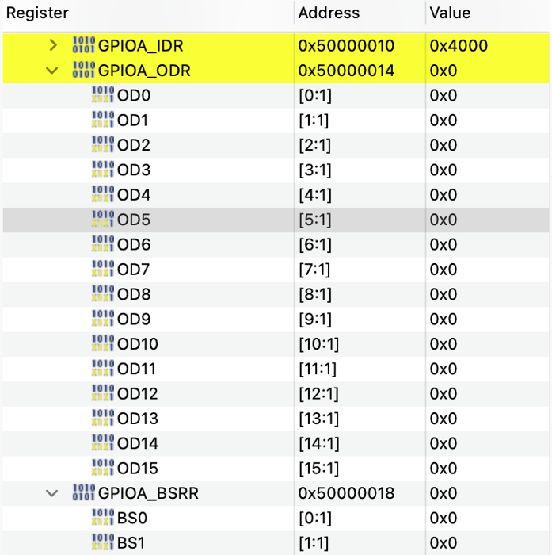

# 01. LED 깜빡이기

> 빈 칩 상태에서 핀을 직접 설정해 사용자 LED를 0.5초 간격으로 깜빡이게 만들고, 같은 동작을 **HAL · 레지스터 직접 접근 · LL** 세 가지 방식으로 구현해 비교한 실습

## 🎯 목표
- STM32CubeMX로 칩을 선택하고 핀을 직접 설정해 프로젝트 만들기
- 생성된 프로젝트를 STM32CubeIDE에서 빌드하고 보드에 올리는 과정 익히기
- GPIO 출력 핀으로 LED 제어하기
- 같은 동작을 HAL, 레지스터 직접 접근(ODR, BSRR), LL 드라이버로 구현하고 차이 이해하기
- 디버거의 SFRs 창으로 레지스터 값이 실제로 바뀌는 것을 확인하기

## 📌 사용한 핀 / 설정
- **MCU**: STM32C031C6T6 (MCU/MPU Selector로 생성)
- **Clock**: 기본 설정 유지 (내부 클럭 사용)
- **구현 방식 선택**: `BLINK_METHOD` 매크로 값(1~4)으로 빌드할 방식을 선택
- **LL 헤더**: `#include "stm32c0xx_ll_gpio.h"` 추가

| 핀 | 모드 | 역할 |
| --- | --- | --- |
| PA5 | GPIO_Output | 사용자 LED (LD4, 초록) / User Label: `LD4` |
| PA13 | SWDIO | 디버그 데이터 (Serial Wire) |
| PA14 | SWCLK | 디버그 클럭 (Serial Wire) |

## 💻 핵심 코드

### 구현 방식 선택
```c
/* USER CODE BEGIN PD */
#define BLINK_METHOD 1   // 1: HAL, 2: 레지스터(ODR), 3: 레지스터(BSRR), 4: LL
/* USER CODE END PD */
```

```c
/* USER CODE BEGIN 3 */
#if   BLINK_METHOD == 1   /* HAL */
    HAL_GPIO_TogglePin(LD4_GPIO_Port, LD4_Pin);
#elif BLINK_METHOD == 2   /* 레지스터: ODR 5번 비트 XOR */
    GPIOA->ODR ^= (1U << 5);
#elif BLINK_METHOD == 3   /* 레지스터: BSRR로 켜기/끄기 */
    if (GPIOA->ODR & (1U << 5)) {
        GPIOA->BSRR = (1U << 21);   // PA5 끄기 (Reset)
    } else {
        GPIOA->BSRR = (1U << 5);    // PA5 켜기 (Set)
    }
#elif BLINK_METHOD == 4   /* LL */
    LL_GPIO_TogglePin(LD4_GPIO_Port, LD4_Pin);
#endif
    HAL_Delay(500);
/* USER CODE END 3 */
```
- `#if ~ #endif`: `BLINK_METHOD` 값에 해당하는 코드만 컴파일한다. 주석 처리보다 방식 전환이 깔끔하다.
- `LD4_GPIO_Port`, `LD4_Pin`: CubeMX에서 PA5에 붙인 User Label `LD4`로 `main.h`에 자동 생성된 매크로다. (`GPIOA`, `GPIO_PIN_5`와 같음)
- `HAL_Delay`: SysTick 타이머를 기준으로 지정한 시간(ms)만큼 기다린다.

### 방식별 동작
| 방식 | 코드 | 동작 |
| --- | --- | --- |
| 1. HAL | `HAL_GPIO_TogglePin()` | 내부에서 ODR을 읽고, BSRR에 Set/Reset 값을 써서 토글 |
| 2. 레지스터 (ODR) | `GPIOA->ODR ^= (1U << 5)` | ODR의 5번 비트만 XOR로 반전 (읽기-수정-쓰기) |
| 3. 레지스터 (BSRR) | `GPIOA->BSRR = (1U << n)` | 현재 상태를 ODR로 확인한 뒤, 켜기(5번) 또는 끄기(21번) 비트에 1을 씀 |
| 4. LL | `LL_GPIO_TogglePin()` | HAL과 같은 방식이지만 파라미터 검사 없이 인라인으로 동작 |

### HAL · LL 내부 구현
두 함수 모두 직접 작성한 3번(BSRR) 방식을 비트 연산 한 줄로 압축한 형태다.
```c
/* HAL (stm32c0xx_hal_gpio.c) */
void HAL_GPIO_TogglePin(GPIO_TypeDef *GPIOx, uint16_t GPIO_Pin)
{
  uint32_t odr;
  assert_param(IS_GPIO_PIN(GPIO_Pin));   // 파라미터 검사 (USE_FULL_ASSERT일 때만 동작)
  odr = GPIOx->ODR;
  GPIOx->BSRR = ((odr & GPIO_Pin) << GPIO_NUMBER) | (~odr & GPIO_Pin);
}

/* LL (stm32c0xx_ll_gpio.h) */
__STATIC_INLINE void LL_GPIO_TogglePin(GPIO_TypeDef *GPIOx, uint32_t PinMask)
{
  uint32_t odr = READ_REG(GPIOx->ODR);
  WRITE_REG(GPIOx->BSRR, ((odr & PinMask) << 16u) | (~odr & PinMask));
}
```
| 연산 | 의미 |
| --- | --- |
| `odr & Pin` | 현재 **켜져 있는** 대상 핀만 추출 |
| `<< 16` | 추출한 비트를 BSRR의 **Reset 영역(16~31번)** 으로 이동 → 끄기 요청 |
| `~odr & Pin` | 현재 **꺼져 있는** 대상 핀만 추출 → Set 영역(0~15번) 켜기 요청 |
| `\|` | 끄기·켜기 요청을 합쳐 BSRR에 **한 번에** 기록 |

## 🎬 결과


`BLINK_METHOD`를 1~4로 바꿔 가며 네 가지 방식 모두 LD4(초록)가 0.5초 간격으로 깜빡이는 것을 확인했다.

### 디버거로 본 레지스터 (SFRs 창)
| LED 꺼짐 | LED 켜짐 |
| :---: | :---: |
|  |  |
| `GPIOA_ODR = 0x0`, `OD5 = 0` | `GPIOA_ODR = 0x20`, `OD5 = 1` |

- `0x20`은 `1U << 5`와 같은 값으로, ODR의 5번 비트만 1이 된 상태다.
- `GPIOA_BSRR`은 LED가 켜질 때도 꺼질 때도 항상 `0x0`으로 읽힌다. (값을 저장하지 않는 레지스터)
- `GPIOA_IDR`의 5번 비트도 함께 바뀌어, ODR에 쓴 값이 실제 핀 출력으로 나간 것을 확인할 수 있다.
- ODR 주소 `0x50000014`는 GPIOA 시작 주소 `0x50000000`에서 `0x14`만큼 떨어진 위치이며, BSRR은 바로 다음 `0x50000018`에 있다.

## 💡 배운 점

### 개발 환경
- **개발 흐름**: CubeMX에서 칩 선택·핀 설정 → 코드 생성 → CubeIDE에서 코드 작성·빌드 → 보드 업로드
- **Board Selector vs MCU Selector**: 보드 단위로 만들면 BSP가 핀을 점유한다. 실무처럼 직접 설계한 보드를 다루려면 칩 단위로 핀을 직접 설정할 줄 알아야 한다.
- **부품 번호 읽기**: STM32 부품 번호의 각 글자는 핀 수, 메모리, 패키지, 온도 범위를 뜻한다.
- **SWD**: PC는 USB로 보드의 ST-LINK와 연결되고, ST-LINK가 PA13(SWDIO)·PA14(SWCLK) 두 선으로 MCU에 코드를 쓰고 디버깅한다. 두 핀은 리셋 직후 기본적으로 SWD로 동작하지만, CubeMX에서 Serial Wire로 명시해 두면 핀이 예약되어 다른 기능에 잘못 할당하는 실수를 막을 수 있다.
- **User Label**: 핀에 이름표를 붙이면 코드에서 핀 번호 대신 의미 있는 이름으로 부를 수 있다.
- **USER CODE 영역**: `/* USER CODE BEGIN */` ~ `/* USER CODE END */` 사이에 작성해야 코드 재생성 시 지워지지 않는다.

### 레지스터
- **레지스터**: 칩 내부의 고정된 주소에 연결된 하드웨어 제어용 칸이다. 일반 변수와 달리 값을 쓰면 실제 하드웨어(핀 출력 등)가 바뀐다. `GPIO_TypeDef` 구조체는 이 주소들에 레지스터 이름을 붙인 지도 역할을 하며, `GPIOA->ODR`은 GPIOA 영역의 ODR 레지스터에 접근한다.
- **ODR (Output Data Register)**: 핀의 출력 상태를 담는 레지스터로, 비트 하나가 핀 하나에 대응한다. `GPIOA->ODR ^= (1U << 5)`는 ODR의 **5번 비트만 XOR로 반전**해 PA5 출력을 켰다 껐다 한다. (`1U << 5`는 5번 비트만 1인 값이며, XOR은 1인 비트만 뒤집고 0인 비트는 그대로 둔다.)
- **BSRR (Bit Set/Reset Register)**: ODR을 조정하는 리모컨 같은 레지스터다. ODR의 n번 비트를 켜려면 BSRR의 n번 비트에, 끄려면 (n+16)번 비트에 1을 쓴다. BSRR은 값을 기억하지 않으며, 1을 쓴 비트에 해당하는 핀만 바뀌고 0을 쓴 비트는 영향이 없다.
- **ODR 대신 BSRR을 쓰는 이유**: ODR을 직접 수정하면 레지스터 값을 읽고-수정하고-다시 쓰는 과정에서, 그 사이에 바뀐 다른 비트(예: 인터럽트가 바꾼 다른 핀)까지 이전 값으로 덮어쓸 수 있다. BSRR은 1을 쓴 비트의 핀만 한 번의 쓰기로 바꾸기 때문에 다른 핀에 영향을 주지 않고 안전하게 제어할 수 있다. 단순히 특정 핀을 켜거나 끌 때도 읽기 없이 쓰기 한 번으로 끝난다.

### 드라이버 비교 (HAL · LL · 레지스터)
- **LL과 HAL의 차이**: LL은 HAL과 같은 방식으로 레지스터를 다루지만, ① 파라미터 검사(`assert_param`)가 없고 ② `__STATIC_INLINE`으로 헤더에 정의되어 함수 호출 없이 호출한 자리에 코드가 삽입되므로 더 가볍고 빠르다. `READ_REG`/`WRITE_REG`는 레지스터 읽기/쓰기를 명시적으로 보여 주는 매크로다.

  | | HAL | LL | 레지스터 직접 |
  | --- | --- | --- | --- |
  | 속도·코드 크기 | 가장 무거움 | 가볍고 빠름 | 가장 가볍고 빠름 |
  | 안전장치 | 파라미터 검사 있음 | 없음 | 없음 |
  | 가독성 | 가장 쉬움 | 쉬움 | 레지스터 이해 필요 |
  | 주 사용처 | 대부분의 기능, 빠른 개발 | 속도·크기가 중요한 부분, 작은 MCU | LL에 없는 기능, 타이밍이 매우 중요한 곳, 부트로더 |

- **실무에서의 선택**: 보통 HAL로 빠르게 구현한 뒤, 느리거나 코드가 큰 부분만 LL로 바꾸고, LL로도 부족할 때 레지스터를 직접 다룬다. LL은 속도뿐 아니라 **코드 크기** 때문에도 선택된다. (STM32C031C6의 Flash는 32KB) LL과 레지스터 중에서는 가독성과 유지보수 측면에서 LL이 우선된다. 회사에 따라 자체 드라이버를 쓰기도 하지만, 어떤 드라이버든 내부에서는 레지스터를 다루므로 레지스터 이해는 공통 역량이다.

### 디버깅
- **SFRs 창**: 브레이크포인트에서 멈춘 상태로 SFRs 창을 열면 레지스터 값을 실시간으로 확인할 수 있다. 코드만 읽어서 이해가 어려운 개념도 레지스터 값과 실제 동작을 함께 관찰하면 빠르게 이해할 수 있고, 하드웨어 동작 문제를 추적할 때도 유용하다.

## 🔍 트러블슈팅
자세한 내용은 [`docs/troubleshooting.md`](../../docs/troubleshooting.md)에 정리했습니다.

| 문제 | 원인 | 해결 |
| --- | --- | --- |
| Board Selector 프로젝트에서 PA5 설정 불가 | BSP가 보드 LED 핀을 점유 | MCU/MPU Selector로 칩을 직접 선택해 재생성 |
| 부품 번호가 여러 개라 선택이 어려움 | 접미사마다 패키지·온도 범위 등이 다름 | 보드 표기(`LQFP48`)를 근거로 `STM32C031C6T6` 선택 |
| SYS에 Debug 항목이 없음 | STM32C0는 Debug 설정 메뉴 위치가 다름 | `Trace and Debug → DEBUG`에서 Serial Wire 활성화 |
| 프로젝트 폴더가 이중으로 생성될 뻔함 | CubeMX가 `위치 + 이름`으로 폴더를 만듦 | Project Location을 상위 폴더(`01_gpio`)로 지정 |
| HAL 내부 비트 연산의 이유를 이해하지 못함 | 레지스터를 일반 변수처럼 생각하고 코드만 읽음 | 디버거 SFRs 창으로 ODR 값과 LED 동작을 함께 관찰 |
| BSRR에 쓴 값이 계속 유지된다고 오해 | BSRR은 값을 저장하지 않고 ODR을 바꾸는 요청만 수행 | SFRs 창에서 BSRR이 항상 `0x0`, ODR만 변하는 것을 확인 |
