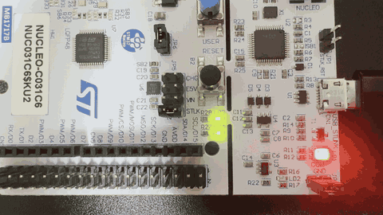

# 01. LED 깜빡이기

> 빈 칩 상태에서 핀을 직접 설정하고, 보드의 사용자 LED를 0.5초 간격으로 깜빡이게 만든 첫 실습

## 🎯 목표
- STM32CubeMX로 칩을 선택하고 핀을 직접 설정해 프로젝트 만들기
- 생성된 프로젝트를 STM32CubeIDE에서 빌드하고 보드에 올리는 과정 익히기
- GPIO 출력 핀으로 LED 제어하기

## 📌 사용한 핀 / 설정
- **MCU**: STM32C031C6T6 (MCU/MPU Selector로 생성)
- **Clock**: 기본 설정 유지 (내부 클럭 사용)

| 핀 | 모드 | 역할 |
| --- | --- | --- |
| PA5 | GPIO_Output | 사용자 LED (LD4, 초록) / User Label: `LD4` |
| PA13 | SWDIO | 디버그 데이터 (Serial Wire) |
| PA14 | SWCLK | 디버그 클럭 (Serial Wire) |

## 💻 핵심 코드
```c
/* USER CODE BEGIN 3 */
HAL_GPIO_TogglePin(LD4_GPIO_Port, LD4_Pin); // LED 상태 뒤집기
HAL_Delay(500);                             // 500ms 기다리기
/* USER CODE END 3 */
```
- `HAL_GPIO_TogglePin`: 핀이 켜져 있으면 끄고, 꺼져 있으면 켠다.
- `HAL_Delay`: SysTick 타이머를 기준으로 지정한 시간(ms)만큼 기다린다.
- `LD4_GPIO_Port`, `LD4_Pin`: CubeMX에서 PA5에 붙인 User Label `LD4`로 자동 생성된 이름이다. (`GPIOA`, `GPIO_PIN_5`와 같음)

## 🎬 결과


LD4(초록)가 0.5초 간격으로 켜지고 꺼지는 것을 확인했다.

## 💡 배운 점
- **개발 흐름**: CubeMX에서 칩 선택·핀 설정 → 코드 생성 → CubeIDE에서 코드 작성·빌드 → 보드 업로드
- **Board Selector vs MCU Selector**: 보드 단위로 만들면 BSP가 핀을 점유한다. 실무처럼 직접 설계한 보드를 다루려면 칩 단위로 핀을 직접 설정할 줄 알아야 한다.
- **부품 번호 읽기**: STM32 부품 번호의 각 글자는 핀 수, 메모리, 패키지, 온도 범위를 뜻한다.
- **SWD**: PA13(SWDIO), PA14(SWCLK) 두 선으로 PC와 보드가 통신해 코드를 올린다. 명시적으로 할당해 두면 다른 용도로 잘못 쓰는 일을 막을 수 있다.
- **User Label**: 핀에 이름표를 붙이면 코드에서 핀 번호 대신 의미 있는 이름으로 부를 수 있다.
- **USER CODE 영역**: `/* USER CODE BEGIN */` ~ `/* USER CODE END */` 사이에 작성해야 코드 재생성 시 지워지지 않는다.

## 🔍 트러블슈팅
자세한 내용은 [`docs/troubleshooting.md`](./docs/troubleshooting.md)에 정리했습니다.

| 문제 | 원인 | 해결 |
| --- | --- | --- |
| Board Selector 프로젝트에서 PA5 설정 불가 | BSP가 보드 LED 핀을 점유 | MCU/MPU Selector로 칩을 직접 선택해 재생성 |
| 부품 번호가 여러 개라 선택이 어려움 | 접미사마다 패키지·온도 범위 등이 다름 | 보드 표기(`LQFP48`)를 근거로 `STM32C031C6T6` 선택 |
| SYS에 Debug 항목이 없음 | STM32C0는 Debug 설정 메뉴 위치가 다름 | `Trace and Debug → DEBUG`에서 Serial Wire 활성화 |
| 프로젝트 폴더가 이중으로 생성될 뻔함 | CubeMX가 `위치 + 이름`으로 폴더를 만듦 | Project Location을 상위 폴더(`01_gpio`)로 지정 |
