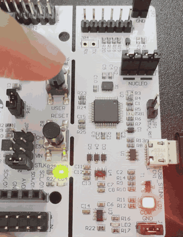
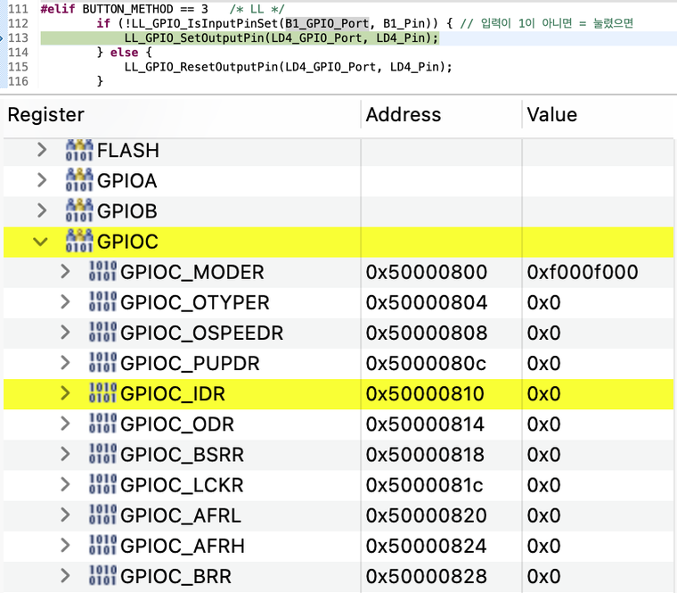
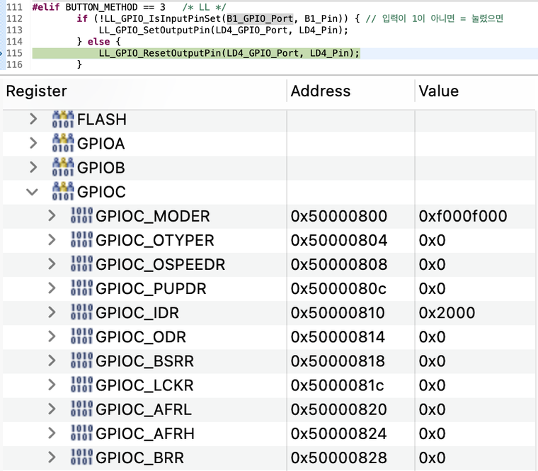

# 02. 버튼으로 LED 제어

> 사용자 버튼(B1)을 누르는 동안만 LED(LD4)가 켜지도록 만들며 GPIO 입력을 익히고, 버튼이 **누르면 0이 되는 이유(풀업 회로)** 를 디버거로 확인한 뒤 **HAL · 레지스터 직접 접근 · LL** 세 가지 방식으로 구현한 실습

## 🎯 목표
- GPIO 입력 핀으로 버튼 상태를 읽고, 그 값에 따라 GPIO 출력(LED) 제어하기
- 버튼을 눌렀을 때 입력 값이 0인지 1인지 디버거로 직접 확인하기
- 풀업·풀다운·플로팅의 개념과 하드웨어(회로)·소프트웨어 설정의 관계 이해하기
- 같은 동작을 HAL, 레지스터(IDR/BSRR), LL로 구현하고 HAL 내부 구현 확인하기

## 📌 사용한 핀 / 설정
- **MCU**: STM32C031C6T6 (MCU/MPU Selector로 생성)
- **Clock**: 기본 설정 유지 (내부 클럭 사용)
- **구현 방식 선택**: `BUTTON_METHOD` 매크로 값(1~3)으로 빌드할 방식을 선택
- **LL 헤더**: `#include "stm32c0xx_ll_gpio.h"` 추가

| 핀 | 모드 | 역할 |
| --- | --- | --- |
| PA5 | GPIO_Output | 사용자 LED (LD4, 초록) / User Label: `LD4` |
| PC13 | GPIO_Input (No pull) | 사용자 버튼 (B1, 파란색) / User Label: `B1` |
| PA13 | SWDIO | 디버그 데이터 (Serial Wire) |
| PA14 | SWCLK | 디버그 클럭 (Serial Wire) |

> PC13은 보드에 이미 풀업 회로가 있어 CubeMX에서 내부 풀업·풀다운을 사용하지 않음(No pull)으로 설정했다.

## 💻 핵심 코드

### 구현 방식 선택
```c
/* USER CODE BEGIN PD */
#define B1_PRESSED     GPIO_PIN_RESET   // B1은 액티브 로우: 누르면 0
#define BUTTON_METHOD  1                // 1: HAL, 2: 레지스터(IDR/BSRR), 3: LL
/* USER CODE END PD */
```

```c
/* USER CODE BEGIN 3 */
#if   BUTTON_METHOD == 1   /* HAL */
    if (HAL_GPIO_ReadPin(B1_GPIO_Port, B1_Pin) == B1_PRESSED) {
        HAL_GPIO_WritePin(LD4_GPIO_Port, LD4_Pin, GPIO_PIN_SET);
    } else {
        HAL_GPIO_WritePin(LD4_GPIO_Port, LD4_Pin, GPIO_PIN_RESET);
    }
#elif BUTTON_METHOD == 2   /* 레지스터: IDR로 읽고 BSRR로 쓰기 */
    if ((GPIOC->IDR & (1U << 13)) == 0) {   // IDR 13번 비트가 0이면 = 눌렸으면
        GPIOA->BSRR = (1U << 5);            // PA5 켜기 (Set)
    } else {
        GPIOA->BSRR = (1U << 21);           // PA5 끄기 (Reset)
    }
#elif BUTTON_METHOD == 3   /* LL */
    if (!LL_GPIO_IsInputPinSet(B1_GPIO_Port, B1_Pin)) {   // 입력이 1이 아니면 = 눌렸으면
        LL_GPIO_SetOutputPin(LD4_GPIO_Port, LD4_Pin);
    } else {
        LL_GPIO_ResetOutputPin(LD4_GPIO_Port, LD4_Pin);
    }
#endif
/* USER CODE END 3 */
```
- `B1_PRESSED`: 버튼이 액티브 로우라는 회로의 특성을 이름으로 감춰, `if` 문이 "버튼이 눌렸으면"으로 바로 읽히게 했다. 회로가 바뀌면 이 한 줄만 고치면 된다.
- `HAL_Delay` 없이 `while` 루프에서 버튼 상태를 계속 확인한다. (폴링 방식)

### 방식별 동작
| 방식 | 읽기 | 쓰기 |
| --- | --- | --- |
| 1. HAL | `HAL_GPIO_ReadPin()` → `GPIO_PIN_SET` / `GPIO_PIN_RESET` 반환 | `HAL_GPIO_WritePin()` |
| 2. 레지스터 | `GPIOC->IDR & (1U << 13)`으로 13번 비트만 확인 | `GPIOA->BSRR`에 Set(5번) / Reset(21번) 비트 기록 |
| 3. LL | `LL_GPIO_IsInputPinSet()` → 1 / 0 반환 | `LL_GPIO_SetOutputPin()` / `LL_GPIO_ResetOutputPin()` |

### HAL 내부 구현
```c
/* HAL_GPIO_ReadPin: IDR에서 대상 핀 비트만 확인 */
if ((GPIOx->IDR & GPIO_Pin) != 0x00U)
    bitstatus = GPIO_PIN_SET;
else
    bitstatus = GPIO_PIN_RESET;

/* HAL_GPIO_WritePin: 켜기는 BSRR, 끄기는 BRR에 기록 */
if (PinState != GPIO_PIN_RESET)
    GPIOx->BSRR = (uint32_t)GPIO_Pin;
else
    GPIOx->BRR = (uint32_t)GPIO_Pin;
```
- 직접 작성한 2번(레지스터) 방식과 같은 일을 하며, HAL은 결과를 `GPIO_PIN_SET` / `GPIO_PIN_RESET`이라는 이름으로 바꿔 돌려준다.
- **BRR (Bit Reset Register)**: 끄기 전용 레지스터로, n번 비트에 1을 쓰면 n번 핀이 꺼진다. `GPIOA->BRR = (1U << 5)`는 `GPIOA->BSRR = (1U << 21)`과 같은 결과다.

## 🎬 결과


`BUTTON_METHOD`를 1~3으로 바꿔 가며 세 가지 방식 모두 B1을 누르는 동안만 LD4가 켜지는 것을 확인했다.

### 디버거로 본 버튼 입력과 코드 흐름 (SFRs 창)
`BUTTON_METHOD == 3`(LL)으로 빌드한 뒤, 한 단계씩 실행하며 IDR 값에 따라 코드가 어느 쪽으로 진행하는지 확인했다.

| 버튼 누름 | 버튼 뗌 |
| :---: | :---: |
|  |  |
| `GPIOC_IDR = 0x0` (13번 비트 = 0) | `GPIOC_IDR = 0x2000` (13번 비트 = 1) |
| → 113번 줄 `LL_GPIO_SetOutputPin` 실행 (LED 켜기) | → 115번 줄 `LL_GPIO_ResetOutputPin` 실행 (LED 끄기) |

- 입력(IDR 13번 비트)이 0이면 `!LL_GPIO_IsInputPinSet()`이 참이 되어 켜기 쪽으로, 1이면 끄기 쪽으로 진행하는 것을 확인했다.
- `0x2000`은 `1U << 13`과 같은 값으로, 버튼을 떼고 있을 때 PC13이 1로 읽힌다.
- `GPIOC_PUPDR = 0x0`: 칩 내부의 풀업·풀다운이 모두 꺼져 있는데도 IDR이 안정적으로 1이므로, **보드에 외부 풀업 회로가 있다**는 것을 알 수 있다.
- `GPIOC_MODER = 0xF000F000`: 핀마다 2비트씩 모드를 나타내며, PC13 자리(26~27번 비트)가 `00`(입력 모드)이다.
- 레지스터 목록에서 HAL 내부에서 사용하는 `GPIOC_BRR`(`0x50000828`)도 확인할 수 있다.

## 💡 배운 점

### 입력 회로
- **액티브 로우(Active Low)**: 보드의 사용자 버튼 B1은 누르지 않으면 1, 누르면 0이 읽힌다. 그래서 "눌렸다"는 조건을 `GPIO_PIN_RESET`(0)으로 판단해야 한다.
- **플로팅(Floating)**: 입력 핀이 어디에도 연결되지 않은 상태로, 주변 전기 잡음에 따라 값이 0과 1 사이를 제멋대로 오간다. 이를 막기 위해 저항으로 기본값을 정해 준다.
- **풀업·풀다운**: 저항으로 입력 핀의 전압을 한쪽으로 약하게 끌어당겨 기본값을 정하는 회로다. 버튼은 이 저항보다 강하게 핀을 반대쪽으로 끌어당긴다.

  | | 저항 연결 | 버튼 연결 | 안 누를 때 | 누를 때 |
  | --- | --- | --- | :---: | :---: |
  | 풀업 (B1) | 3.3V | GND | 1 | 0 |
  | 풀다운 | GND | 3.3V | 0 | 1 |

  저항 대신 전선으로 바로 연결하면 버튼을 누르는 순간 3.3V와 GND가 이어져 합선이 되므로, 약하게 당기는 저항을 사용한다.
- **누가 정하는가**: 버튼이 눌렸을 때 0인지 1인지는 **회로를 설계한 사람**이 정한다. B1처럼 보드에 납땜된 회로는 소프트웨어로 바꿀 수 없으며, 펌웨어 개발자는 회로도를 보고 이에 맞게 코드를 작성한다.
- **하드웨어와 소프트웨어 설정 맞추기**: 보드에 이미 풀업 저항이 있는데 소프트웨어에서 내부 풀다운을 켜면 두 저항이 반대로 당겨 값이 불안정해지고 전류가 계속 흐른다. 따라서 **외부 저항이 있으면 No pull**, 없으면 버튼 연결 방향에 맞춰 내부 풀업 또는 풀다운을 선택한다.

### 레지스터
- **IDR (Input Data Register)**: 핀으로 들어오는 실제 전기 상태를 칩이 계속 기록하는 읽기 전용 레지스터다. `GPIOC->IDR & (1U << 13)`으로 13번 비트만 확인해 PC13의 입력 값을 읽는다.
- **PUPDR**: 칩 내부 풀업·풀다운 설정을 담는 레지스터로, CubeMX의 Pull-up/Pull-down 설정이 여기에 반영된다.
- **BRR (Bit Reset Register)**: 끄기 전용 레지스터로, BSRR의 Reset 영역(n+16번)과 달리 n번 비트에 1을 쓰면 n번 핀이 꺼진다.

### 코드 작성
- **회로 특성은 이름으로 감추기**: `#define B1_PRESSED GPIO_PIN_RESET`처럼 회로의 사정을 이름으로 정의하면 코드를 읽기 쉽고, 회로가 바뀌어도 한 곳만 고치면 된다.
- **폴링(Polling)**: `while` 루프에서 입력을 계속 확인하는 방식이다. 루프 안에 `HAL_Delay()`처럼 기다리는 코드가 있으면 그동안 버튼을 확인하지 못해 반응이 늦어지거나 짧은 입력을 놓칠 수 있다. 이 한계는 이후 인터럽트로 해결할 수 있다.
- **HAL 내부 읽기**: HAL 함수는 대부분 "파라미터 검사 → 레지스터 한두 줄" 구조이므로, 함수의 정확한 동작이 궁금할 때 내부 구현을 열어 보면 어떤 레지스터를 사용하는지 바로 알 수 있다.

## 🔍 트러블슈팅
자세한 내용은 [`docs/troubleshooting.md`](../../docs/troubleshooting.md)에 정리했습니다.

| 문제 | 원인 | 해결 |
| --- | --- | --- |
| 버튼을 누르면 LED가 꺼지고, 떼면 켜짐 (예상과 반대) | B1은 풀업 회로라 누르면 0(액티브 로우)인데, 눌렀을 때 1이라고 가정함 | 디버거로 IDR 13번 비트 확인 후, 조건을 `GPIO_PIN_RESET`(`B1_PRESSED`)으로 변경 |
