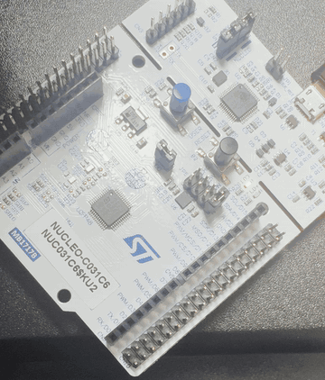
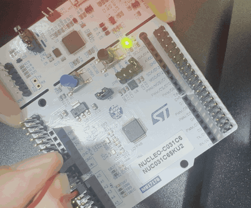
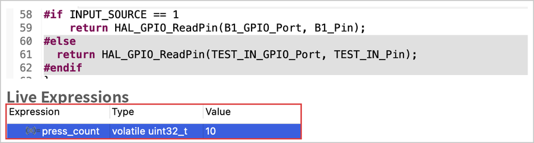
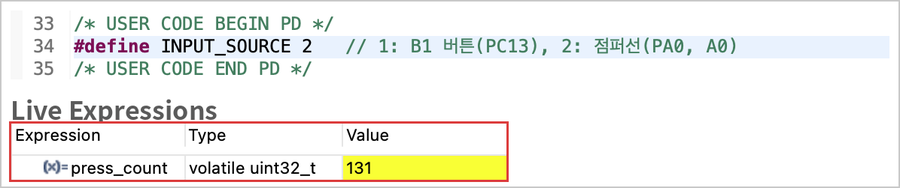
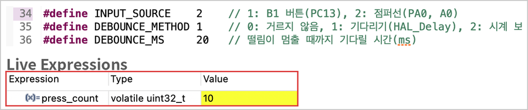
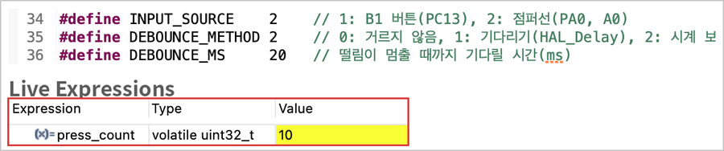

# 03. 버튼 토글 & 디바운싱

> 버튼을 **한 번 누를 때마다** LED(LD4)가 켜짐 ↔ 꺼짐으로 바뀌도록 만들며 **눌리는 순간(엣지)** 을 찾는 방법을 익히고, 버튼 접점이 떨리는 **바운싱**을 디버거로 측정한 뒤 **소프트웨어 디바운싱** 두 가지 방식으로 해결한 실습. 버튼 읽기와 LED 토글은 **HAL · LL · 레지스터 직접 접근**으로 비교했다.

관련 기초 노트: [기초 04. 보드 회로도 확인](../../docs/basics/04_board_schematic.md) (B1 회로의 C16·R26)

## 🎯 목표
- 이전 값과 현재 값을 비교해 버튼이 **눌리는 순간(1 → 0)** 에만 동작하는 토글 만들기
- 버튼을 한 번 눌렀을 때 칩이 몇 번 "눌렸다"고 읽는지 측정해 **바운싱**을 직접 확인하기
- 보드 버튼(B1)과 점퍼선 입력을 비교해, B1 회로의 **C16·R26(하드웨어 디바운싱)** 역할 확인하기
- **기다리기(`HAL_Delay`)** 와 **시간 비교(`HAL_GetTick`)** 두 가지 소프트웨어 디바운싱을 구현하고 차이 이해하기
- 버튼 읽기와 LED 토글을 HAL, LL, 레지스터로 구현하고 HAL·LL 내부 구현 비교하기

## 📌 사용한 핀 / 설정
- **MCU**: STM32C031C6T6 (MCU/MPU Selector로 생성)
- **Clock**: 기본 설정 유지 (내부 클럭 사용)
- **LL 헤더**: `#include "stm32c0xx_ll_gpio.h"` 추가

| 핀 | 모드 | 역할 |
| --- | --- | --- |
| PA5 | GPIO_Output | 사용자 LED (LD4) / User Label: `LD4` |
| PC13 | GPIO_Input (No pull) | 사용자 버튼 (B1) / User Label: `B1` — 보드에 외부 풀업(R29)이 있음 |
| PA0 | GPIO_Input (Pull-up) | 점퍼선으로 GND에 연결하는 비교용 입력 (보드의 **A0**) / User Label: `TEST_IN` |
| PA13 | SWDIO | 디버그 데이터 (Serial Wire) |
| PA14 | SWCLK | 디버그 클럭 (Serial Wire) |

> 두 입력 모두 **풀업 + 누르면(연결하면) GND** 구조라, 평소 1이고 누르면 0이다. B1은 보드 위 R29, PA0은 칩 안의 풀업을 사용한다.

### 실험 선택 매크로
| 매크로 | 값 | 의미 |
| --- | --- | --- |
| `INPUT_SOURCE` | `1` / `2` | 입력: B1(PC13) / 점퍼선(PA0) |
| `DEBOUNCE_METHOD` | `0` / `1` / `2` | 거르지 않음 / 기다리기(`HAL_Delay`) / 시간 비교(`HAL_GetTick`) |
| `DEBOUNCE_MS` | `20` | 떨림이 멈췄다고 판단할 시간(ms) |
| `DRIVER_METHOD` | `1` / `2` / `3` | 읽기·토글 구현: HAL / LL / 레지스터 |

## 💻 핵심 코드

### 1. 설정 매크로
```c
/* USER CODE BEGIN PD */
#define INPUT_SOURCE    1    // 1: B1 버튼(PC13), 2: 점퍼선(PA0, A0)
#define DEBOUNCE_METHOD 2    // 0: 거르지 않음, 1: 기다리기(HAL_Delay), 2: 시간 비교(HAL_GetTick)
#define DEBOUNCE_MS     20   // 떨림이 멈출 때까지 기다릴 시간(ms)
#define DRIVER_METHOD   1    // 1: HAL, 2: LL, 3: 레지스터 직접

#if INPUT_SOURCE == 1
#define INPUT_PORT  B1_GPIO_Port
#define INPUT_PIN   B1_Pin
#else
#define INPUT_PORT  TEST_IN_GPIO_Port
#define INPUT_PIN   TEST_IN_Pin
#endif
/* USER CODE END PD */

/* USER CODE BEGIN PV */
volatile uint32_t press_count = 0;   // "눌렸다"고 읽힌 횟수 (디버거로 관찰)
/* USER CODE END PV */
```
- `volatile`: 디버거가 실행 중에 값을 읽는 변수이므로, 컴파일러가 최적화로 없애거나 레지스터에만 두지 않도록 표시했다.

### 2. 읽기 · 토글 함수 (HAL / LL / 레지스터)
```c
/* USER CODE BEGIN 0 */
static GPIO_PinState Read_Input(void)
{
#if DRIVER_METHOD == 1
  return HAL_GPIO_ReadPin(INPUT_PORT, INPUT_PIN);
#elif DRIVER_METHOD == 2
  return LL_GPIO_IsInputPinSet(INPUT_PORT, INPUT_PIN) ? GPIO_PIN_SET : GPIO_PIN_RESET;
#else
  return (INPUT_PORT->IDR & INPUT_PIN) ? GPIO_PIN_SET : GPIO_PIN_RESET;   // IDR에서 대상 핀 비트만 확인
#endif
}

static void Toggle_LED(void)
{
#if DRIVER_METHOD == 1
  HAL_GPIO_TogglePin(LD4_GPIO_Port, LD4_Pin);
#elif DRIVER_METHOD == 2
  LL_GPIO_TogglePin(LD4_GPIO_Port, LD4_Pin);
#else
  uint32_t odr = LD4_GPIO_Port->ODR;                                 // 현재 출력 상태 읽기
  LD4_GPIO_Port->BSRR = ((odr & LD4_Pin) << 16) | (~odr & LD4_Pin);  // 켜져 있으면 Reset, 꺼져 있으면 Set
#endif
}
/* USER CODE END 0 */
```

| 현재 LED (ODR 5번 비트) | `(odr & LD4_Pin) << 16` | `~odr & LD4_Pin` | BSRR에 쓰는 값 | 결과 |
| :---: | --- | --- | --- | :---: |
| 1 (켜짐) | 21번 비트 = 1 | 0 | Reset 5번 | 꺼짐 |
| 0 (꺼짐) | 0 | 5번 비트 = 1 | Set 5번 | 켜짐 |

### 3. 눌리는 순간 찾기 + 디바운싱
```c
/* USER CODE BEGIN 2 */
GPIO_PinState prev_state = Read_Input();          // 이전 값
#if DEBOUNCE_METHOD == 2
GPIO_PinState stable_state = prev_state;          // 떨림이 멈춘 뒤 확정한 값
uint32_t last_change_tick = HAL_GetTick();        // 마지막으로 값이 바뀐 시각(ms)
#endif
/* USER CODE END 2 */
```
```c
/* USER CODE BEGIN 3 */
GPIO_PinState now_state = Read_Input();           // 현재 값

#if DEBOUNCE_METHOD == 0      /* 거르지 않음: 1 → 0 이면 바로 인정 */
if (prev_state == GPIO_PIN_SET && now_state == GPIO_PIN_RESET) {
  press_count++;
  Toggle_LED();
}

#elif DEBOUNCE_METHOD == 1    /* 기다리기: 1 → 0 을 보면 잠시 기다린 뒤 다시 확인 */
if (prev_state == GPIO_PIN_SET && now_state == GPIO_PIN_RESET) {
  HAL_Delay(DEBOUNCE_MS);
  if (Read_Input() == GPIO_PIN_RESET) {           // 그래도 0이면 실제 눌림
    press_count++;
    Toggle_LED();
  }
}

#elif DEBOUNCE_METHOD == 2    /* 시간 비교: 값이 DEBOUNCE_MS 동안 유지되면 확정 */
if (now_state != prev_state) {                    // 값이 바뀜 (떨리는 중일 수 있음)
  last_change_tick = HAL_GetTick();               // 시간을 처음부터 다시 측정
}
if ((HAL_GetTick() - last_change_tick) >= DEBOUNCE_MS && now_state != stable_state) {
  stable_state = now_state;                       // 새 값으로 확정
  if (stable_state == GPIO_PIN_RESET) {           // 새로 확정한 값이 0 = 실제 눌림
    press_count++;
    Toggle_LED();
  }
}
#endif

prev_state = now_state;                           // 현재 값을 이전 값으로 저장
/* USER CODE END 3 */
```
- **엣지 검출**: "지금 눌려 있는가"가 아니라 **이전 1 → 현재 0**으로 바뀐 순간에만 동작한다. 버튼을 계속 누르고 있으면 두 값이 모두 0이라 다시 토글되지 않는다.
- **방법 1 (기다리기)**: 첫 1 → 0을 본 뒤 20ms 동안 떨림이 끝나기를 기다린다. 뗄 때의 떨림 속에 1 → 0이 섞여도, 20ms 뒤에는 이미 1(뗀 상태)이라 무시된다.
- **방법 2 (시간 비교)**: 값이 바뀔 때마다 시각을 새로 기록하고, **20ms 동안 바뀌지 않았을 때만** 값을 확정한다. 기다리는 동안 멈추지 않고 루프가 계속 돈다.
- `HAL_GetTick() - last_change_tick`처럼 **빼기로 비교**하면, 1ms마다 증가하는 tick 값이 약 49일 뒤 0으로 돌아가도 경과 시간이 올바르게 계산된다.

### 디바운싱 방식 비교
| | 방법 1: 기다리기 (`HAL_Delay`) | 방법 2: 시간 비교 (`HAL_GetTick`) |
| --- | --- | --- |
| 떨림을 거르는 방법 | 20ms 동안 멈춰서 기다린 뒤 다시 확인 | 값이 20ms 동안 유지됐는지 시간만 비교 |
| 기다리는 동안 CPU | 다른 일을 할 수 없음 (블로킹) | 루프가 계속 돌아 다른 작업 가능 (논블로킹) |
| 코드 | 짧고 단순함 | 상태 변수(`stable_state`, `last_change_tick`)가 필요함 |
| 사용 | 간단한 테스트 | 여러 작업을 함께 처리하는 실제 펌웨어 |

### HAL · LL 내부 구현
```c
/* HAL_GPIO_TogglePin */
void HAL_GPIO_TogglePin(GPIO_TypeDef *GPIOx, uint16_t GPIO_Pin)
{
  uint32_t odr;
  assert_param(IS_GPIO_PIN(GPIO_Pin));      // 파라미터 검사
  odr = GPIOx->ODR;                         // 현재 출력 상태 읽기
  GPIOx->BSRR = ((odr & GPIO_Pin) << GPIO_NUMBER) | (~odr & GPIO_Pin);
}

/* LL_GPIO_TogglePin */
__STATIC_INLINE void LL_GPIO_TogglePin(GPIO_TypeDef *GPIOx, uint32_t PinMask)
{
  uint32_t odr = READ_REG(GPIOx->ODR);
  WRITE_REG(GPIOx->BSRR, ((odr & PinMask) << 16u) | (~odr & PinMask));
}
```
- 두 함수 모두 **ODR을 읽어 현재 상태를 확인하고, BSRR에 반대 동작(Set 또는 Reset)을 쓰는** 같은 구조이며, 직접 작성한 레지스터 코드(`DRIVER_METHOD 3`)와도 같다. (`GPIO_NUMBER` = 16)
- 차이점: HAL은 일반 함수 호출이며 `assert_param`으로 핀 값이 올바른지 검사한다. LL은 `__STATIC_INLINE`으로 호출한 자리에 코드가 그대로 들어가고 검사가 없다.
- ODR에 직접 `^=`(XOR)로 쓰지 않고 BSRR을 사용해, 같은 포트의 다른 핀 출력은 건드리지 않는다. ([LED 실습](../01_led_blink)에서 비교)

## 🎬 결과

| B1 버튼 | 점퍼선 (PA0 ↔ GND, 디바운싱 없음) |
| :---: | :---: |
|  |  |
| 누를 때마다 LD4가 한 번씩 바뀜 | 꽂을 때 그대로이거나 뺄 때 바뀌는 등 동작이 불규칙함 |

### 바운싱 측정 (Live Expressions)
디버거의 **Live Expressions** 창에서 `press_count`를 관찰하며, 같은 동작을 10번 했을 때 "눌렸다"고 읽힌 횟수를 측정했다.

| 실험 | 입력 | 디바운싱 | 10번 동작 후 `press_count` |
| :---: | --- | --- | :---: |
| A | B1 | 0: 없음 | **10** |
| B | 점퍼선 | 0: 없음 | **131** (한 번 연결할 때 10 이상씩 증가) |
| C | 점퍼선 | 1: 기다리기 (20ms) | **10** |
| D-1 | 점퍼선 | 2: 시간 비교 (20ms) | **10** |
| D-2 | B1 | 2: 시간 비교 (20ms) | **10** |

| 실험 A: B1, 디바운싱 없음 | 실험 B: 점퍼선, 디바운싱 없음 |
| :---: | :---: |
|  |  |

| 실험 C: 점퍼선, 기다리기 | 실험 D-1: 점퍼선, 시간 비교 | 실험 D-2: B1, 시간 비교 |
| :---: | :---: | :---: |
|  |  |  |

- 실험 A는 바운싱 비교 매크로를 추가하기 전에 측정해, 화면에 `DEBOUNCE_METHOD`가 없다. (회색 음영 = `#if` 조건에 맞지 않아 빌드에서 빠진 코드)
- 점퍼선은 손으로 금속을 맞대는 순간 접점이 여러 번 붙었다 떨어져, 한 번 연결에 10번 이상 "눌렸다"고 읽혔다. 디바운싱을 적용하자 두 방식 모두 정확히 10이 되었다.
- B1은 디바운싱 없이도 10번이 정확히 읽혔다. B1 회로에 있는 **C16(100nF)·R26(100Ω)** 이 전압 변화를 부드럽게 만들어 주고, 버튼 자체도 스위치용 부품이기 때문으로 보인다. ([기초 04](../../docs/basics/04_board_schematic.md)) 다만 이번 실험에서 떨림이 관찰되지 않았다는 뜻이며, 모든 버튼에서 떨림이 없다는 뜻은 아니다.
- `DRIVER_METHOD`를 1~3으로 바꿔 가며 세 방식 모두 B1을 누를 때마다 LD4가 토글되는 것을 확인했다.

## 💡 배운 점

### 입력 처리
- **폴링 (Polling)**: 칩은 버튼을 계속 지켜보는 것이 아니라, `Read_Input()`이 실행되는 순간에만 핀 값을 읽는다. Step Over로 한 줄씩 실행하면 읽는 줄을 지날 때만 값이 바뀌는 것을 확인할 수 있다. `while` 루프가 매우 빠르게 반복되기 때문에 누르자마자 반응하는 것처럼 보인다. 버튼이 칩에 직접 알려 주는 방식은 이후 **인터럽트(EXTI)** 로 배울 예정이다.
- **엣지 검출**: 상태(눌려 있는가)가 아닌 변화(1 → 0)를 찾으려면 **이전 값을 변수에 저장**해 두고 현재 값과 비교해야 한다.
- **바운싱 (Bouncing)**: 기계식 접점은 붙거나 떨어지는 순간 짧은 시간 동안 여러 번 붙었다 떨어진다. 칩은 이를 모두 읽기 때문에 한 번의 입력이 여러 번으로 처리된다. 토글이 짝수 번 일어나면 LED가 원래 상태로 돌아가 **바뀌지 않은 것처럼** 보인다.
- **디바운싱 (Debouncing)**
  - **하드웨어**: 커패시터·저항(B1의 C16·R26)으로 전압 변화를 부드럽게 만든다.
  - **소프트웨어**: 값이 일정 시간(이번 실습은 20ms) 유지될 때만 인정한다. 실무에서는 CPU를 멈추지 않는 **시간 비교 방식**을 주로 사용한다.

### 레지스터 · 드라이버
- **토글 = ODR 읽기 + BSRR 쓰기**: HAL, LL, 레지스터 구현 모두 현재 출력(ODR)을 보고 BSRR에 반대 동작을 쓴다. 드라이버의 차이는 **파라미터 검사와 함수 호출 방식(일반 함수 / 인라인)** 이다.
- **`HAL_GetTick()`**: `HAL_Init()`이 설정한 1ms 주기 타이머(SysTick)로 증가하는 값이며, 경과 시간은 `현재 tick - 기록한 tick`으로 계산한다.

### 디버깅
- **Live Expressions**: 프로그램을 멈추지 않고 변수 값을 실시간으로 볼 수 있어, 바운싱처럼 빠르게 일어나는 현상의 **횟수를 측정**하는 데 유용하다. 일반 Expressions 창은 프로그램이 멈췄을 때만 값이 갱신된다.
- **Run과 Resume의 차이**: 툴바의 **Run**은 프로그램을 올린 뒤 디버거 연결을 끊는다. 실행 중인 값을 보려면 **Debug**로 시작한 뒤 **Resume(F8)** 으로 실행을 이어 가야 한다.
- **회로도 → 코드 → 측정**: 기초 04에서 회로도로 찾은 C16·R26의 역할을, 점퍼선과의 비교 측정으로 확인할 수 있었다.

## 🔍 트러블슈팅
자세한 내용은 [`docs/troubleshooting.md`](../../docs/troubleshooting.md)에 정리했습니다.

| 문제 | 원인 | 해결 |
| --- | --- | --- |
| 버튼을 누르면 변수 값이 저절로 바뀐다고 생각함 | 칩은 입력을 읽는 코드가 실행될 때만 핀 값을 가져옴 (폴링) | Step Over로 읽는 줄을 지날 때만 값이 바뀌는 것을 확인 |
| 점퍼선으로 한 번 연결해도 `press_count`가 10 이상 증가하고 LED가 불규칙하게 바뀜 | 접점의 바운싱으로 1 → 0이 여러 번 발생 (트랜지스터 문제로 추측했으나 아니었음) | Live Expressions로 횟수 측정 후, 20ms 소프트웨어 디바운싱 적용 |
| Run으로 실행하면 Live Expressions 값을 볼 수 없음 | Run은 디버거 연결 없이 실행하는 버튼 | Debug로 시작한 뒤 Resume(F8)으로 실행 |
