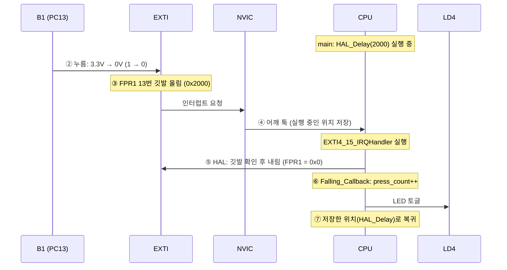
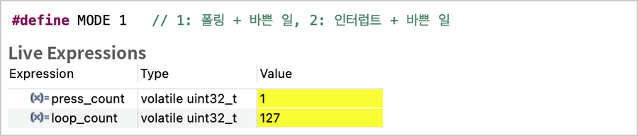
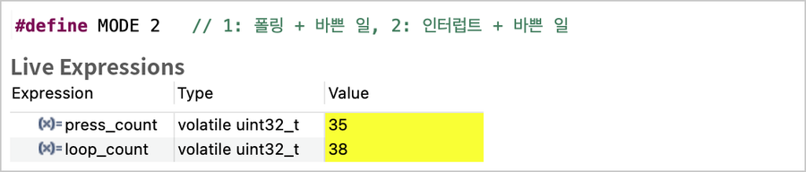
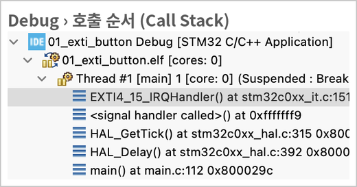
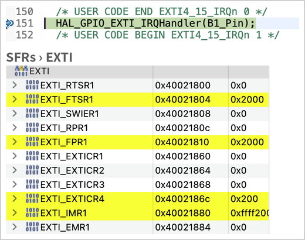
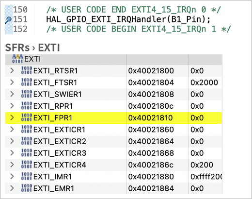

# 01. 외부 인터럽트(EXTI)로 버튼 처리

> CPU를 일부러 2초씩 바쁘게 만든 상태에서 **폴링**과 **외부 인터럽트(EXTI)** 로 버튼을 처리해 반응 차이를 측정하고, 디버거로 인터럽트가 걸리는 순간의 **호출 순서**와 **EXTI 레지스터(깃발)** 변화를 확인한 실습

관련 실습: [03. 버튼 토글 & 디바운싱](../../01_gpio/03_button_toggle) (폴링으로 눌리는 순간 찾기)

## 🎯 목표
- CPU가 다른 일(`HAL_Delay`)로 바쁠 때, 폴링이 짧은 버튼 입력을 놓치는 것을 직접 확인하기
- 같은 상황에서 외부 인터럽트(EXTI)는 버튼을 놓치지 않고 바로 반응하는 것을 확인하기
- 버튼을 누른 순간부터 콜백 함수가 실행되고 원래 코드로 돌아오기까지의 **전체 흐름** 이해하기
- 디버거(SFRs 창)로 EXTI의 **Falling 감지 깃발(FPR1)** 이 올라가고 내려가는 것 확인하기

## 📌 사용한 핀 / 설정
- **MCU**: STM32C031C6T6 (MCU/MPU Selector로 생성)
- **Clock**: 기본 설정 유지 (내부 클럭 사용)

| 핀 | 모드 | 역할 |
| --- | --- | --- |
| PA5 | GPIO_Output | 사용자 LED (LD4) / User Label: `LD4` |
| PC13 | **GPIO_EXTI13** | 사용자 버튼 (B1) / User Label: `B1` |
| PA13 | SWDIO | 디버그 데이터 (Serial Wire) |
| PA14 | SWCLK | 디버그 클럭 (Serial Wire) |

### CubeMX 설정
| 위치 | 설정 | 의미 |
| --- | --- | --- |
| Pinout | PC13 → `GPIO_EXTI13` | PC13을 인터럽트를 걸 수 있는 입력으로 사용 |
| GPIO → PC13 | `External Interrupt Mode with Falling edge trigger detection` | 전압이 **1 → 0으로 떨어지는 순간(Falling)** 에 인터럽트 발생. B1은 누르면 0이 되므로 "누르는 순간" |
| GPIO → PC13 | `No pull-up and no pull-down` | 보드에 외부 풀업(R29)이 있음 |
| NVIC | `EXTI line 4 to 15 interrupts` → **Enabled** | CPU가 EXTI 4~15번 인터럽트를 받도록 허용. STM32C0은 4~15번 핀이 인터럽트 하나를 함께 사용 |

NVIC를 켜면 `MX_GPIO_Init()` 마지막에 다음 코드가 생성된다.
```c
HAL_NVIC_SetPriority(EXTI4_15_IRQn, 0, 0);
HAL_NVIC_EnableIRQ(EXTI4_15_IRQn);
```

## 💻 핵심 코드

### 실험 모드 선택
```c
/* USER CODE BEGIN PD */
#define MODE 1   // 1: 폴링 + 바쁜 일, 2: 인터럽트 + 바쁜 일
/* USER CODE END PD */

/* USER CODE BEGIN PV */
volatile uint32_t press_count = 0;   // LED를 토글한 횟수
volatile uint32_t loop_count  = 0;   // while이 한 바퀴 돈 횟수
/* USER CODE END PV */
```
- `volatile`: 인터럽트 모드에서 `press_count`는 `main`이 모르는 사이에 콜백 함수에서 바뀐다. 컴파일러가 값을 미리 저장해 두고 재사용하지 않도록, 매번 메모리에서 다시 읽게 한다.

### main 루프: 폴링 + 바쁜 일
```c
/* USER CODE BEGIN 2 */
#if MODE == 1
GPIO_PinState prev_state = HAL_GPIO_ReadPin(B1_GPIO_Port, B1_Pin);
#endif
/* USER CODE END 2 */
```
```c
/* USER CODE BEGIN 3 */
loop_count++;

#if MODE == 1   /* 폴링: 바쁜 일 사이사이에 버튼 확인 */
GPIO_PinState now_state = HAL_GPIO_ReadPin(B1_GPIO_Port, B1_Pin);
if (prev_state == GPIO_PIN_SET && now_state == GPIO_PIN_RESET) {
  press_count++;
  HAL_GPIO_TogglePin(LD4_GPIO_Port, LD4_Pin);
}
prev_state = now_state;
#endif

HAL_Delay(2000);   // CPU가 2초 동안 다른 일로 바쁜 상황
/* USER CODE END 3 */
```

### 인터럽트 콜백
```c
/* USER CODE BEGIN 4 */
#if MODE == 2
void HAL_GPIO_EXTI_Falling_Callback(uint16_t GPIO_Pin)
{
  if (GPIO_Pin == B1_Pin) {                      // 인터럽트를 일으킨 핀이 B1이면
    press_count++;
    HAL_GPIO_TogglePin(LD4_GPIO_Port, LD4_Pin);
  }
}
#endif
/* USER CODE END 4 */
```
- 이 함수는 코드에서 직접 호출하지 않는다. 버튼이 눌리면 하드웨어가 CPU를 멈추고, HAL을 거쳐 자동으로 호출된다.
- **함수 이름 주의**: STM32C0 HAL은 콜백이 **Falling / Rising으로 나뉘어** 있다. 다른 STM32 예제에 많은 `HAL_GPIO_EXTI_Callback`으로 작성하면 호출되지 않는다.
- 콜백은 `main`의 일을 잠시 멈추고 실행되므로, `HAL_Delay`처럼 오래 걸리는 코드는 넣지 않고 **짧게** 작성한다.

## 🔔 인터럽트 전체 흐름

> 👉 [**인터럽트 흐름 실험실 ▶ 바로 실행하기**](https://t4330n.github.io/embedded-journey/02_timer_interrupt/01_exti_button/sim/interrupt-flow.html) (AI의 도움을 받아 만든 학습용 시뮬레이션)
> 아래 8단계를 한 단계씩 넘기며, 단계마다 일하는 부품과 바뀌는 값을 확인할 수 있습니다. 소스: [`sim/interrupt-flow.html`](./sim/interrupt-flow.html)



| 단계 | 무엇이 일어나나 | 무엇이 바뀌나 | 누가 하나 |
| :---: | --- | --- | :---: |
| ⓪ 준비 | `MX_GPIO_Init()`이 EXTI를 PC13에 연결하고 Falling 감지·인터럽트를 켬 | `EXTICR4 = 0x200`(C포트), `FTSR1` 13번 = 1, `IMR1` 13번 = 1, NVIC ON | 코드 (CubeMX 생성) |
| ① 평소 | CPU는 `HAL_Delay(2000)`으로 바쁨. 버튼을 확인하지 않음 | `loop_count`가 2초마다 +1 | 코드 |
| ② 누름 | B1이 PC13 넷을 GND에 연결 | PC13: 3.3V → **0V** | 하드웨어 |
| ③ 감지 | EXTI 회로가 1 → 0을 알아채고 깃발을 올림 | `FPR1 = 0x2000` | 하드웨어 |
| ④ 호출 | NVIC가 CPU에 알리고, CPU는 하던 위치를 저장한 뒤 핸들러로 이동 | 실행 위치: `HAL_Delay` → `EXTI4_15_IRQHandler` | 하드웨어 |
| ⑤ 정리 | `HAL_GPIO_EXTI_IRQHandler`가 깃발을 확인하고 1을 써서 내림 | `FPR1 = 0x0` | 코드 (HAL) |
| ⑥ 처리 | HAL이 우리가 작성한 콜백을 호출 | `press_count` +1, LD4 토글 | 코드 (직접 작성) |
| ⑦ 복귀 | 저장해 둔 위치(`HAL_Delay`)로 돌아가 하던 일을 계속함 | 실행 위치: 다시 `HAL_Delay` | 하드웨어 |

- **알아채기(②~④)는 하드웨어**, **처리하기(⑤~⑥)는 소프트웨어**가 한다. CPU는 버튼을 직접 확인하지 않아도 된다.
- CPU가 어떤 함수로 이동할지는 `startup_stm32c031c6tx.s`의 **벡터 테이블**(인터럽트별 함수 목록)에 `EXTI4_15_IRQHandler`로 정해져 있다.

### HAL 내부 구현
```c
/* stm32c0xx_it.c: CubeMX가 생성한 인터럽트 핸들러 */
void EXTI4_15_IRQHandler(void)
{
  HAL_GPIO_EXTI_IRQHandler(B1_Pin);
}

/* stm32c0xx_hal_gpio.c */
void HAL_GPIO_EXTI_IRQHandler(uint16_t GPIO_Pin)
{
  if (__HAL_GPIO_EXTI_GET_RISING_IT(GPIO_Pin) != 0x00u)   // RPR1: 0 → 1 깃발
  {
    __HAL_GPIO_EXTI_CLEAR_RISING_IT(GPIO_Pin);
    HAL_GPIO_EXTI_Rising_Callback(GPIO_Pin);
  }

  if (__HAL_GPIO_EXTI_GET_FALLING_IT(GPIO_Pin) != 0x00u)  // FPR1: 1 → 0 깃발
  {
    __HAL_GPIO_EXTI_CLEAR_FALLING_IT(GPIO_Pin);           // 깃발 내리기
    HAL_GPIO_EXTI_Falling_Callback(GPIO_Pin);             // 우리 콜백 호출
  }
}
```
| 매크로 | 실제 동작 |
| --- | --- |
| `__HAL_GPIO_EXTI_GET_FALLING_IT(pin)` | `EXTI->FPR1 & pin` — 해당 핀의 Falling 깃발 확인 |
| `__HAL_GPIO_EXTI_CLEAR_FALLING_IT(pin)` | `EXTI->FPR1 = pin` — 해당 비트에 **1을 써서** 깃발을 지움 |

- **깃발을 지우지 않으면**: 핸들러가 끝나도 깃발이 남아 있어 CPU가 곧바로 다시 핸들러로 들어가고, 이것이 끝없이 반복되어 `main`으로 돌아가지 못한다. HAL은 콜백을 부르기 **전에** 깃발부터 지운다.
- **1을 써서 지운다**: FPR1은 깃발이 있는 비트에 1을 쓰면 0으로 지워지는 레지스터다. 다른 핀의 깃발에 영향을 주지 않고 원하는 비트만 지울 수 있다. ([BSRR](../../01_gpio/01_led_blink)처럼 "1을 쓴 비트만 동작"하는 방식)

## 🎬 결과

### 폴링 vs 인터럽트 (CPU가 2초씩 바쁠 때)
| 실험 | 방식 | 한 일 | 결과 |
| :---: | --- | --- | --- |
| A-1 | 폴링 | B1을 짧게 10번 누르기 | `press_count` = **1** — 대부분 놓침 |
| A-2 | 폴링 | B1을 3초 이상 누르고 있기 | 누르고 있으면 `HAL_Delay`가 끝난 뒤에야 바뀜 (최대 2초 늦음) |
| B | 인터럽트 | B1을 짧게 누르기 | **누를 때마다 바로** LD4 토글. `loop_count`는 그대로 2초마다 +1 |

| A-1: 폴링, 짧게 10번 | A-2: 폴링, 길게 누르기 | B: 인터럽트, 짧게 누르기 |
| :---: | :---: | :---: |
|  |  |  |

- **폴링이 놓친 이유**: 버튼을 읽는 순간은 아주 짧고, 다음 읽기까지 2초의 빈틈이 있다. 0.2초쯤 되는 짧은 누름이 이 빈틈에 들어가면 읽히지 않는다. (0.2초 ÷ 2초 ≈ 10번 중 1번 → 실험 결과 1과 일치)
- **인터럽트가 놓치지 않은 이유**: EXTI 회로가 핀을 항상 지켜보다가 1 → 0이 되는 순간 깃발(FPR1)을 올려 두므로, CPU가 바빠도 입력이 사라지지 않는다.
- 실험 B의 `press_count` 35는 여러 번 시도하며 누적된 값이다.

### 인터럽트가 걸린 순간의 호출 순서
`EXTI4_15_IRQHandler` 안에 브레이크포인트를 걸고 B1을 눌러 멈춘 화면이다.



- 아래에서 위로 읽으면 `main` → `HAL_Delay` → `HAL_GetTick`을 실행하던 중 **`<signal handler called>`(인터럽트 발생)** 를 거쳐 `EXTI4_15_IRQHandler`로 들어왔다.
- CPU가 `HAL_Delay`로 기다리는 **도중에 하드웨어가 끼어든** 것을 확인할 수 있다.

### 디버거로 본 EXTI 깃발 (SFRs 창)
| 깃발 내리기 전 (151번 줄에서 멈춤) | `HAL_GPIO_EXTI_IRQHandler` 실행 후 (Step Over) |
| :---: | :---: |
|  |  |
| `FPR1 = 0x2000` (13번 깃발 올라감) | `FPR1 = 0x0` (HAL이 깃발을 내림) |

| 레지스터 | 값 | 의미 |
| --- | :---: | --- |
| `FTSR1` | `0x2000` | 13번 핀의 **Falling(1 → 0)** 을 감지하도록 설정 (CubeMX의 Falling edge) |
| `FPR1` | `0x2000` → `0x0` | 13번 **Falling 감지 깃발**. 하드웨어가 올리고, HAL이 1을 써서 내림 |
| `EXTICR4` | `0x200` | EXTI 13번을 **C포트**(값 2)의 13번 핀에 연결 |
| `IMR1` | 13번 비트 = 1 | EXTI 13번 인터럽트를 CPU 쪽으로 전달하도록 허용 |

- `0x2000`은 `1U << 13`으로, [버튼 실습](../../01_gpio/02_button_led)에서 본 `GPIOC_IDR = 0x2000`과 같은 "13번 비트"다.

## 💡 배운 점

### 폴링과 인터럽트
- **폴링**은 소프트웨어(`while` 안의 읽기 코드)가 직접 확인해서 입력을 알아채고, **인터럽트**는 하드웨어(EXTI·NVIC)가 알아채서 소프트웨어(콜백)를 불러 준다. LED를 바꾸는 처리는 둘 다 코드가 한다.
- 폴링은 CPU가 다른 일로 바쁘면 그동안 입력을 확인하지 못해, **짧은 입력을 놓치거나 반응이 늦어진다.**
- 인터럽트도 "값이 바뀌었는지" 누군가는 확인한다. 다만 그 확인을 **EXTI 회로가 항상** 하고, CPU는 명령어를 실행할 때마다 하드웨어로 인터럽트 요청이 있는지만 확인하므로, 코드에 확인 주기를 만들 필요가 없다.

### 구성 요소
- **EXTI**: 핀의 전압 변화(Rising/Falling)를 감지해 깃발(RPR1/FPR1)을 올리는 회로
- **NVIC**: 어떤 인터럽트를 CPU에 전달할지 켜고 끄는 관리자. CubeMX의 NVIC 탭에서 Enabled로 켠다.
- **벡터 테이블**: 인터럽트마다 실행할 함수(`EXTI4_15_IRQHandler` 등)의 목록으로, startup 파일에 있다.
- **콜백**: HAL이 깃발 정리 등 공통 처리를 끝낸 뒤 호출해 주는, 사용자가 작성하는 함수다.

### 작성 규칙
- 콜백 이름은 HAL에 정의된 `__weak` 함수 이름과 정확히 같아야 한다. (STM32C0: `HAL_GPIO_EXTI_Falling_Callback` / `Rising_Callback`)
- 인터럽트에서 바꾸는 전역 변수에는 `volatile`을 붙인다.
- 콜백은 짧게 작성하고, 기다리는 코드(`HAL_Delay`)는 넣지 않는다.

### 더 공부할 것
- 여러 인터럽트가 동시에 발생할 때의 **우선순위(NVIC Priority)**
- HAL 없이 EXTI 레지스터(`EXTICR`, `FTSR1`, `IMR1`)와 `NVIC_EnableIRQ`로 직접 설정하는 방법

## 🔍 트러블슈팅
자세한 내용은 [`docs/troubleshooting.md`](../../docs/troubleshooting.md)에 정리했습니다.

| 문제 | 원인 | 해결 |
| --- | --- | --- |
| CPU가 바쁠 때 폴링으로 짧게 누른 버튼을 대부분 놓침 | 버튼을 읽는 순간은 짧고, 다음 읽기까지 2초의 빈틈이 있음 | EXTI 인터럽트로 변경해 하드웨어가 입력을 감지하도록 함 |
| 인터럽트는 값이 바뀐 것을 언제·어떻게 확인하는지 이해되지 않음 | 확인을 코드가 아닌 EXTI 회로와 CPU 하드웨어가 함 | 브레이크포인트로 호출 순서와 FPR1 깃발 변화를 직접 확인 |
