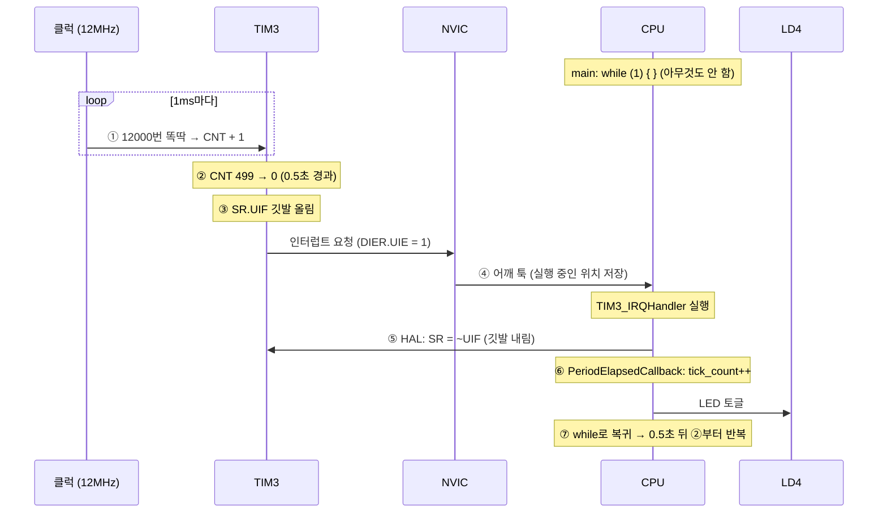
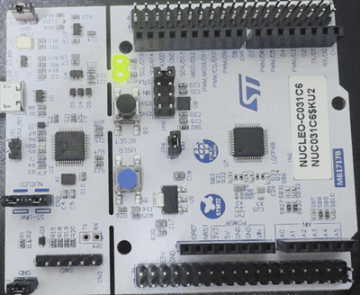
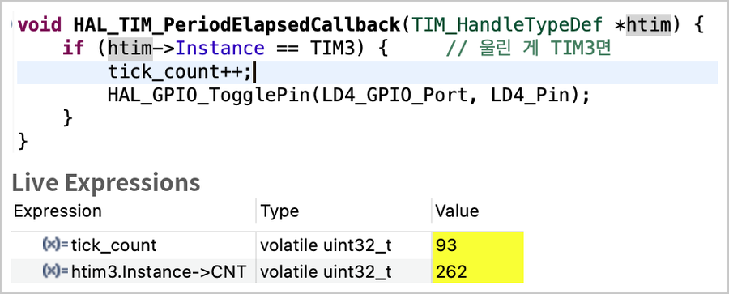
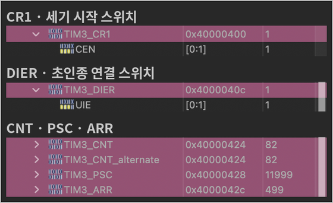
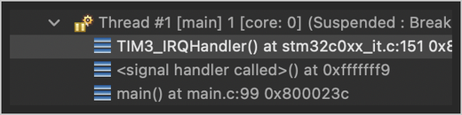
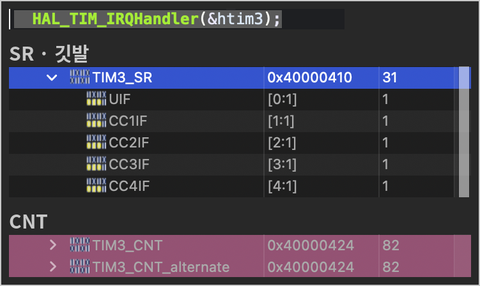
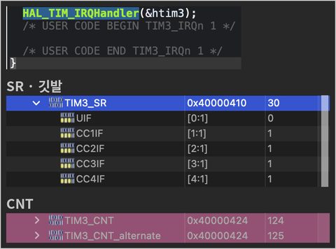

# 02. 타이머 인터럽트로 LED 깜빡이기

> `HAL_Delay` 없이 **하드웨어 타이머(TIM3)** 가 0.5초마다 인터럽트를 일으켜 LED(LD4)를 토글하도록 만들고, **PSC·ARR 값을 바꿔 가며** 주기가 계산대로 바뀌는지 확인한 뒤, 디버거로 타이머 레지스터와 **업데이트 깃발(UIF)** 변화를 관찰한 실습

관련 실습: [01. 외부 인터럽트(EXTI)로 버튼 처리](../01_exti_button) (인터럽트 흐름이 같고, 초인종을 울리는 쪽만 버튼 → 타이머로 바뀜)

## 🎯 목표
- `while` 루프에 코드가 없어도, 타이머가 정해진 주기마다 인터럽트로 LED를 토글하게 만들기
- 프리스케일러(PSC)와 자동 재장전 값(ARR)이 주기를 어떻게 결정하는지 계산하고 실험으로 확인하기
- CubeMX 설정과 `HAL_TIM_Base_Start_IT()`가 실제로 어떤 타이머 레지스터를 바꾸는지 디버거로 확인하기
- 타이머 인터럽트의 전체 흐름을 EXTI 인터럽트와 비교해 이해하기

## 📌 사용한 핀 / 설정
- **MCU**: STM32C031C6T6 (MCU/MPU Selector로 생성)
- **Clock**: 기본 설정 유지 — HSI 48MHz ÷ 4 = **12MHz** (Clock Configuration의 `APB Timer clocks` 값)

| 핀 / 주변장치 | 모드 | 역할 |
| --- | --- | --- |
| PA5 | GPIO_Output | 사용자 LED (LD4) / User Label: `LD4` |
| TIM3 | Internal Clock | 0.5초마다 업데이트 인터럽트 발생 |
| PA13 / PA14 | SWDIO / SWCLK | 디버그 (Serial Wire) |

### TIM3 설정
| 위치 | 설정 | 의미 |
| --- | --- | --- |
| Mode → Clock Source | `Internal Clock` | 칩 내부 클럭(12MHz)으로 숫자를 셈 |
| Prescaler (PSC) | `12000-1` | 클럭 12000번마다 카운터(CNT)를 1 증가 → **한 칸 = 1ms** |
| Counter Mode | `Up` | 0부터 위로 셈 |
| Counter Period (ARR) | `500-1` | CNT가 499에 닿으면 0으로 돌아가며 업데이트 발생 → **500칸 = 0.5초** |
| NVIC Settings | `TIM3 global interrupt` → **Enabled** | 업데이트 깃발이 서면 CPU에 인터럽트 전달 |

### 주기 계산
```
주기 = (PSC + 1) × (ARR + 1) ÷ 타이머 클럭
     = 12000 × 500 ÷ 12,000,000 = 0.5초
```
```
클럭 12,000,000번/초
   │  PSC: 12000번마다 한 칸
   ▼
CNT 1,000칸/초 (한 칸 = 1ms)
   │  ARR: 500칸마다 업데이트
   ▼
인터럽트 2번/초 (0.5초마다) → LED 토글
```
- `-1`을 붙이는 이유: 카운터가 **0부터** 세기 때문이다. 0\~499는 500칸이다. `11999`보다 `12000-1`로 쓰면 의도가 바로 보인다.

## 💻 핵심 코드

### 타이머 시작
```c
/* USER CODE BEGIN 2 */
HAL_TIM_Base_Start_IT(&htim3);   // 업데이트 인터럽트를 켜고 카운터 시작
/* USER CODE END 2 */
```

### 업데이트 인터럽트 콜백
```c
/* USER CODE BEGIN 4 */
volatile uint32_t tick_count = 0;   // 인터럽트가 발생한 횟수

void HAL_TIM_PeriodElapsedCallback(TIM_HandleTypeDef *htim)
{
  if (htim->Instance == TIM3) {     // 인터럽트를 일으킨 타이머가 TIM3이면
    tick_count++;
    HAL_GPIO_TogglePin(LD4_GPIO_Port, LD4_Pin);
  }
}
/* USER CODE END 4 */
```
- `while (1)` 안에는 아무 코드도 없다. LED 토글은 전부 타이머 인터럽트가 처리한다.
- 하나의 콜백 함수를 모든 타이머가 함께 사용하므로, `htim->Instance`로 **어느 타이머인지** 확인한다.

### HAL 내부 구현
```c
/* HAL_TIM_Base_Start_IT (요약) */
__HAL_TIM_ENABLE_IT(htim, TIM_IT_UPDATE);   // DIER |= UIE   : 업데이트 인터럽트 켜기
__HAL_TIM_ENABLE(htim);                     // CR1  |= CEN   : 카운터 시작

/* HAL_TIM_IRQHandler (업데이트 부분 요약) */
if ((itflag & TIM_FLAG_UPDATE) == TIM_FLAG_UPDATE)        // SR의 UIF 확인
{
  if ((itsource & TIM_IT_UPDATE) == TIM_IT_UPDATE)        // DIER의 UIE 확인
  {
    __HAL_TIM_CLEAR_FLAG(htim, TIM_FLAG_UPDATE);          // SR = ~UIF : 깃발 내리기
    HAL_TIM_PeriodElapsedCallback(htim);                  // 우리 콜백 호출
  }
}
```

| 매크로 | 실제 동작 |
| --- | --- |
| `__HAL_TIM_ENABLE_IT(htim, TIM_IT_UPDATE)` | `TIM3->DIER \|= TIM_DIER_UIE` |
| `__HAL_TIM_ENABLE(htim)` | `TIM3->CR1 \|= TIM_CR1_CEN` |
| `__HAL_TIM_CLEAR_FLAG(htim, TIM_FLAG_UPDATE)` | `TIM3->SR = ~TIM_SR_UIF` |

- **`SR = ~UIF`로 깃발을 내리는 이유**: SR의 깃발은 **0을 쓰면 지워지고 1을 쓰면 그대로**인 비트다. `~UIF`는 UIF 자리만 0이고 나머지는 1이므로, **UIF 하나만** 지워진다.
- `SR &= ~UIF`(읽기-수정-쓰기)를 쓰지 않는 이유: 읽은 직후 하드웨어가 다른 깃발을 새로 올리면, 다시 쓸 때 그 깃발을 0으로 덮어써 **놓칠 수 있다**. 한 번 쓰기로 처리하면 이런 문제가 없다. ([BSRR을 쓰는 이유](../../01_gpio/01_led_blink)와 같다)
- EXTI와의 비교: EXTI `FPR1`은 **1을 쓰면** 지워져서 `FPR1 = 깃발`, TIM `SR`은 **0을 쓰면** 지워져서 `SR = ~깃발`로 쓴다. 방식은 반대지만 "한 번 쓰기로 원하는 깃발만"이라는 목적은 같다.

## ⏰ 타이머 인터럽트 전체 흐름

> 👉 [**타이머 흐름 실험실 ▶ 바로 실행하기**](https://t4330n.github.io/embedded-journey/02_timer_interrupt/02_timer_blink/sim/timer-flow.html) (AI의 도움을 받아 만든 학습용 시뮬레이션)
> 아래 8단계를 한 단계씩 넘기며, 단계마다 일하는 부품, 바뀌는 값, CNT가 차오르는 모습을 확인할 수 있습니다. 소스: [`sim/timer-flow.html`](./sim/timer-flow.html)



| 단계 | 무엇이 일어나나 | 무엇이 바뀌나 | 누가 하나 |
| :---: | --- | --- | :---: |
| ⓪ 준비 | `MX_TIM3_Init()`이 PSC·ARR 설정, `HAL_TIM_Base_Start_IT()`가 인터럽트를 켜고 카운터 시작 | `PSC = 11999`, `ARR = 499`, `DIER.UIE = 1`, `CR1.CEN = 1` | 코드 |
| ① 세기 | 클럭 12000번마다 CNT가 1 증가. CPU는 관여하지 않음 | `CNT`: 0 → 1 → … (1ms마다) | 하드웨어 |
| ② 넘침 | CNT가 ARR(499)에 닿은 뒤 0으로 돌아감 (업데이트) | `CNT`: 499 → 0 | 하드웨어 |
| ③ 깃발 | 업데이트 순간 깃발을 올림. CNT는 바로 다음 바퀴를 셈 | `SR.UIF = 1` | 하드웨어 |
| ④ 호출 | UIE가 켜져 있으므로 NVIC가 CPU에 알리고, CPU는 위치를 저장한 뒤 핸들러로 이동 | 실행 위치: `main` → `TIM3_IRQHandler` | 하드웨어 |
| ⑤ 정리 | `HAL_TIM_IRQHandler`가 UIF·UIE를 확인하고 깃발을 내림 | `SR.UIF = 0` | 코드 (HAL) |
| ⑥ 처리 | HAL이 우리가 작성한 콜백을 호출 | `tick_count` +1, LD4 토글 | 코드 (직접 작성) |
| ⑦ 복귀·반복 | 저장한 위치(`while`)로 돌아감. 0.5초 뒤 ②부터 반복 | 실행 위치: 다시 `main` | 하드웨어 |

- EXTI와 비교하면 **②\~③의 "초인종을 누르는 쪽"만** 버튼에서 타이머로 바뀌고, ④\~⑦은 같다.
- 버튼은 사람이 누를 때만 울리지만, 타이머는 **스스로 계속 세면서 정해진 간격마다** 울린다.

## 🎬 결과



`while (1)`이 비어 있는데도 LD4가 0.5초마다 켜졌다 꺼졌다.

### 동작 확인 (Live Expressions)
CNT 262" width="560">

- `tick_count = 93`: 인터럽트가 93번 발생했다 (93 × 0.5초 ≈ 46초 동안 실행).
- `htim3.Instance->CNT = 262`: 마지막 인터럽트 후 262ms가 지난 순간이다. CNT는 0\~499를 계속 반복한다.

### PSC · ARR 바꿔 보기
`HAL_TIM_Base_Start_IT()` 바로 위에 값을 바꾸는 코드를 넣고 LED 속도를 비교했다.

| 실험 | 추가한 코드 | 계산 | 관찰 |
| :---: | --- | --- | --- |
| 기본 | (없음) | 12000 × 500 ÷ 12M = **0.5초** | 0.5초마다 토글 |
| C-1 | `__HAL_TIM_SET_AUTORELOAD(&htim3, 1000-1);` | 12000 × 1000 ÷ 12M = **1초** | 느려짐 |
| C-2 | `__HAL_TIM_SET_AUTORELOAD(&htim3, 100-1);` | 12000 × 100 ÷ 12M = **0.1초** | 가장 빠름 |
| C-3 | `__HAL_TIM_SET_PRESCALER(&htim3, 24000-1);` | 24000 × 500 ÷ 12M = **1초** | C-1과 같은 속도 |

- C-1(ARR을 2배)과 C-3(PSC를 2배)은 방법이 다르지만 같은 1초가 되었다. "몇까지 셀까"를 늘리든 "얼마나 천천히 셀까"를 늘리든 한 바퀴 시간은 같아진다.
- 계산과 관찰 결과가 일치해, 타이머 클럭이 **12MHz**라는 것도 확인했다.

### 디버거로 본 TIM3 레지스터 (SFRs 창)
| 설정이 들어간 레지스터 | 인터럽트가 걸린 순간의 호출 순서 |
| :---: | :---: |
|  |  |
| `CEN = 1`, `UIE = 1`, `PSC = 11999`, `ARR = 499` | `main` → `<signal handler called>` → `TIM3_IRQHandler` |

| 깃발 내리기 전 (151번 줄에서 멈춤) | `HAL_TIM_IRQHandler` 실행 후 (Step Over) |
| :---: | :---: |
|  |  |
| `SR = 31` (UIF = 1) | `SR = 30` (UIF = 0) |

- **UIF만 1 → 0**으로 바뀌었고, 나머지 깃발(CC1IF\~CC4IF)은 1로 남았다. `SR = ~UIF`가 UIF 하나만 지운다는 것을 확인했다.
- **CC1IF\~CC4IF가 1인 이유**: 사용하지 않는 비교 채널(CC1\~CC4)이 CNT = 0에서 일치를 감지해 깃발을 올린 것이다. 하지만 `DIER`의 `CC1IE~CC4IE`가 0이라 **인터럽트는 발생하지 않는다**. 깃발이 서도 DIER에서 켠 깃발만 인터럽트를 일으킨다.
- **CPU가 멈춰 있는 동안에도 CNT가 82 → 124로 증가**했다. 타이머가 CPU와 별개로 동작하는 하드웨어라는 증거다.

### 이번 실습에서 사용한 TIM3 레지스터
| 종류 | 레지스터 | 역할 |
| --- | --- | --- |
| 숫자 | `PSC` | 클럭 몇 번마다 한 칸 셀지 (분주) |
| 숫자 | `ARR` | 몇 칸까지 세고 처음으로 돌아갈지 |
| 숫자 | `CNT` | 지금까지 센 값 |
| 스위치 | `CR1.CEN` | 카운터 시작 / 정지 |
| 스위치 | `DIER.UIE` | 업데이트 깃발이 서면 인터럽트를 일으킬지 |
| 깃발 | `SR.UIF` | 업데이트(넘침)가 일어났음을 표시 |

## 💡 배운 점

### 타이머
- 타이머는 CPU와 별개로 **혼자 숫자를 세는 하드웨어**다. 정해진 값까지 세면 인터럽트로 알려 주므로, CPU는 `HAL_Delay`처럼 시간을 확인하며 기다릴 필요가 없다.
- **PSC**는 "얼마나 천천히 셀까", **ARR**은 "몇까지 셀까"이며, 주기 = (PSC + 1) × (ARR + 1) ÷ 타이머 클럭이다.
- 타이머 설정의 출발점은 **타이머 클럭 확인**이다. 같은 설정도 클럭이 다르면 주기가 달라진다.

### PSC · ARR 정하는 법
- 0\~65535(16비트) 사이라면 어떤 값도 동작하지만, 실무에서는 PSC로 **1ms나 1µs처럼 딱 떨어지는 눈금**을 먼저 만들고 ARR로 칸 수를 정해 계산을 쉽게 한다.
- 눈금이 촘촘할수록(1µs) 정밀하지만 ARR 최대값 때문에 잴 수 있는 시간이 짧아지고(약 65ms), 눈금이 넉넉할수록(1ms) 긴 시간(약 65초)을 잴 수 있지만 세밀하지 않다.
- 클럭이 빠르면 원하는 PSC가 65535를 넘을 수 있으므로, 값이 레지스터 범위에 들어가는지 확인한다.

### 인터럽트 공통
- EXTI와 타이머 인터럽트는 **깃발 → NVIC → 핸들러 → HAL이 깃발 정리 → 콜백 → 복귀**라는 같은 흐름을 따른다. 인터럽트를 일으키는 하드웨어만 다르다.
- 깃발은 하드웨어가 올리고, **인터럽트 허용 비트(DIER, IMR)** 가 켜진 깃발만 실제 인터럽트를 일으킨다.
- 깃발을 지우는 방식(1을 써서 / 0을 써서)은 레지스터마다 다르므로, HAL 매크로나 레퍼런스 매뉴얼에서 확인한다.

### 더 공부할 것
- HAL 없이 레지스터(`PSC`, `ARR`, `DIER`, `CR1`)와 `NVIC_EnableIRQ`로 직접 타이머 설정하기
- 타이머로 일정 주기마다 버튼을 확인하는 디바운싱, PWM(5단계)

## 🔍 트러블슈팅
자세한 내용은 [`docs/troubleshooting.md`](../../docs/troubleshooting.md)에 정리했습니다.

| 문제 | 원인 | 해결 |
| --- | --- | --- |
| CubeMX의 타이머 설정(PSC·ARR)을 따라 했지만 무슨 뜻인지, 값을 어떻게 정하는지 이해되지 않음 | 클럭·분주·카운터의 관계를 숫자로만 봄 | 먼저 동작시킨 뒤 PSC·ARR을 바꿔 가며 주기 변화를 관찰하고, 레지스터 값을 디버거로 확인 |
