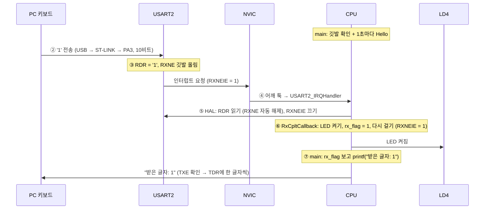
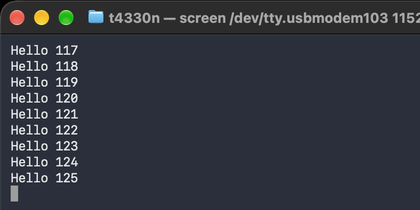
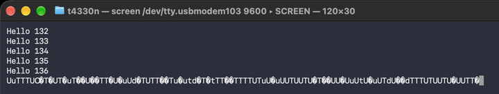
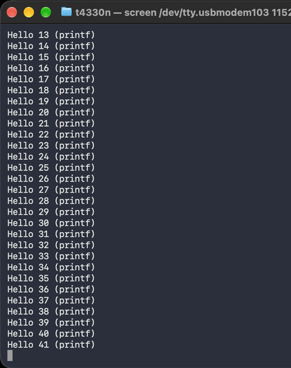
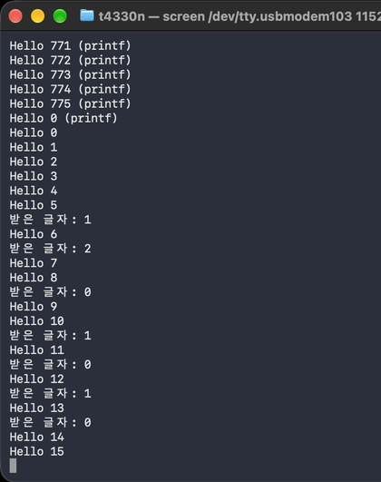
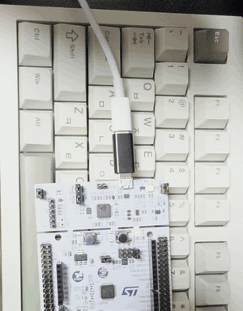
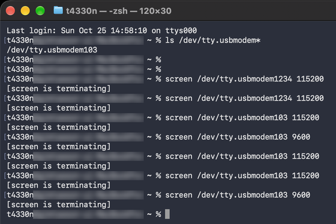

# 01. UART로 PC와 통신하기 (보내기 · printf · 인터럽트 받기)

> 보드의 USART2로 PC 터미널에 글자를 보내고, `printf`를 UART로 연결해 디버깅 출력을 만든 뒤, **키보드 입력을 인터럽트로 받아 LED를 제어**한 실습. 보드레이트를 일부러 틀리게 맞춰 글자가 깨지는 것도 확인했다.

관련 실습: [외부 인터럽트(EXTI)](../../02_timer_interrupt/01_exti_button) · [타이머 인터럽트](../../02_timer_interrupt/02_timer_blink) (받기는 같은 인터럽트 흐름을 따름)

## 🎯 목표
- USART2로 PC에 문자열을 보내고, 보드레이트(통신 속도)가 맞지 않으면 어떻게 되는지 확인하기
- `printf` 출력을 UART로 연결해, 디버거 없이도 값을 화면에 찍을 수 있게 하기
- `HAL_UART_Transmit` 내부에서 어떤 깃발과 레지스터로 글자를 보내는지 확인하기
- PC 키보드 입력을 **인터럽트로 받아** LED를 켜고 끄기, 그리고 "다시 걸기"가 왜 필요한지 확인하기

## 📌 사용한 핀 / 설정
- **MCU**: STM32C031C6T6 (MCU/MPU Selector로 생성)
- **Clock**: 기본 설정 유지 (12MHz)
- **PC 쪽**: macOS 터미널의 `screen` (`screen /dev/tty.usbmodem103 115200`)

| 핀 / 주변장치 | 모드 | 역할 |
| --- | --- | --- |
| PA2 | USART2_TX | 보드 → PC 보내기 |
| PA3 | USART2_RX | PC → 보드 받기 |
| PA5 | GPIO_Output | 사용자 LED (LD4) / User Label: `LD4` |
| PA13 / PA14 | SWDIO / SWCLK | 디버그 (Serial Wire) |

> NUCLEO-C031C6은 PA2·PA3가 보드의 ST-LINK에 연결되어 있어, **USB 케이블 하나로** PC의 가상 COM 포트(VCP)와 통신할 수 있다. 별도 배선이 필요 없다. (보드 사용자 매뉴얼 UM2953)

### USART2 설정
| 위치 | 설정 | 의미 |
| --- | --- | --- |
| Mode | `Asynchronous` | 시계 선 없이, 서로 약속한 속도로만 통신 |
| Baud Rate | `115200` | 1초에 115,200비트. PC 터미널과 **같은 값**이어야 함 |
| Word Length / Parity / Stop Bits | `8 Bits` / `None` / `1` | 글자 하나 = 시작 1 + 데이터 8 + 정지 1 = **10비트** |
| NVIC Settings | `USART2 global interrupt` → **Enabled** | 받기를 인터럽트로 처리 (실험 E) |

## 💻 핵심 코드

### 1. 문자열 보내기 (실험 A·B)
```c
char msg[32];
int len = snprintf(msg, sizeof(msg), "Hello %lu\r\n", hello_count);   // "Hello 0" 문장 만들기
HAL_UART_Transmit(&huart2, (uint8_t *)msg, len, 100);                 // USART2로 보내기
```
| 인자 | 의미 |
| --- | --- |
| `&huart2` | 사용할 UART |
| `(uint8_t *)msg` | 보낼 데이터의 주소 |
| `len` | 보낼 글자 수 |
| `100` | 최대 대기 시간(ms). 이 시간 안에 못 보내면 `HAL_TIMEOUT` |

- `\r\n`: `\r`은 줄 맨 앞으로, `\n`은 다음 줄로. 터미널에서 다음 줄 처음부터 출력되려면 둘 다 필요하다.

### 2. printf를 UART로 연결 (실험 C)
```c
/* USER CODE BEGIN 0 */
int __io_putchar(int ch)                                        // printf가 글자 하나를 내보낼 때 호출
{
  HAL_UART_Transmit(&huart2, (uint8_t *)&ch, 1, HAL_MAX_DELAY);
  return ch;
}
/* USER CODE END 0 */

/* USER CODE BEGIN 2 */
setvbuf(stdout, NULL, _IONBF, 0);                               // 출력 버퍼 없이 바로 보내기
/* USER CODE END 2 */
```
```
printf("Hello …")
 → _write()              // Core/Src/syscalls.c (CubeIDE 생성)
   → __io_putchar(ch)    // 직접 작성, 한 글자씩
     → HAL_UART_Transmit()
```
- `printf`는 출력할 곳이 정해져 있지 않은 함수다. 보드에는 화면이 없으므로, `syscalls.c`의 `_write`가 부르는 `__io_putchar`를 작성해 **출력 대상을 UART로** 정했다.

### 3. 키보드 입력을 인터럽트로 받기 (실험 E)
```c
/* USER CODE BEGIN PV */
uint32_t hello_count = 0;
uint8_t  rx_byte;                 // 받은 글자가 저장될 칸 (HAL이 채움)
volatile uint8_t rx_flag = 0;     // "글자 왔다" 깃발
volatile uint8_t last_char = 0;   // 마지막으로 받은 글자
/* USER CODE END PV */
```
```c
/* USER CODE BEGIN 2 */
setvbuf(stdout, NULL, _IONBF, 0);
HAL_UART_Receive_IT(&huart2, &rx_byte, 1);   // 글자 1개를 인터럽트로 받도록 요청
uint32_t last_hello = HAL_GetTick();
/* USER CODE END 2 */
```
```c
/* USER CODE BEGIN 3 */
if (rx_flag) {                               // 콜백이 세운 깃발을 main에서 처리
  rx_flag = 0;
  printf("받은 글자: %c\r\n", last_char);
}

if (HAL_GetTick() - last_hello >= 1000) {    // HAL_Delay 없이 1초마다 출력
  last_hello = HAL_GetTick();
  printf("Hello %lu\r\n", hello_count++);
}
/* USER CODE END 3 */
```
```c
/* USER CODE BEGIN 4 */
void HAL_UART_RxCpltCallback(UART_HandleTypeDef *huart)
{
  if (huart->Instance == USART2) {
    if (rx_byte == '1') HAL_GPIO_WritePin(LD4_GPIO_Port, LD4_Pin, GPIO_PIN_SET);
    if (rx_byte == '0') HAL_GPIO_WritePin(LD4_GPIO_Port, LD4_Pin, GPIO_PIN_RESET);
    last_char = rx_byte;
    rx_flag = 1;                                   // 깃발만 세우고
    HAL_UART_Receive_IT(&huart2, &rx_byte, 1);     // 다음 글자를 위해 다시 요청
  }
}
/* USER CODE END 4 */
```
- **콜백은 짧게, 출력은 main에서**: `printf`는 19글자에 약 1.65ms가 걸린다. 콜백에서는 LED 제어와 깃발 세우기만 하고, 출력은 main이 깃발을 보고 처리한다.
- **`HAL_Delay` 대신 `HAL_GetTick()` 비교**: main이 멈추지 않아야 깃발을 바로 확인할 수 있다. ([디바운싱 방법 2](../../01_gpio/03_button_toggle)와 같은 방식)
- **다시 걸기**: `HAL_UART_Receive_IT(..., 1)`은 **정한 글자 수만큼만** 받는 일회성 요청이다. 다 받으면 HAL이 수신 인터럽트를 끄므로, 계속 받으려면 콜백에서 다시 요청해야 한다.

### HAL 내부 구현
```c
/* HAL_UART_Transmit (보내기 반복 부분) */
while (huart->TxXferCount > 0U)
{
  if (UART_WaitOnFlagUntilTimeout(huart, UART_FLAG_TXE, RESET, tickstart, Timeout) != HAL_OK)
  { huart->gState = HAL_UART_STATE_READY; return HAL_TIMEOUT; }   // TXE: 보낼 칸이 빌 때까지 대기
  huart->Instance->TDR = (uint8_t)(*pdata8bits & 0xFFU);          // TDR: 한 글자 넣기
  pdata8bits++;
  huart->TxXferCount--;
}
if (UART_WaitOnFlagUntilTimeout(huart, UART_FLAG_TC, RESET, tickstart, Timeout) != HAL_OK)
{ ... }                                                            // TC: 마지막 글자 전송 완료까지 대기
```
| 이름 | 종류 | 의미 |
| --- | --- | --- |
| `TDR` | 레지스터 | 보낼 글자를 넣는 칸 |
| `TXE` | 깃발 | TDR이 비었다 → 다음 글자를 넣어도 됨 |
| `TC` | 깃발 | 마지막 글자까지 선으로 완전히 나갔다 |
| `RDR` | 레지스터 | 받은 글자가 들어오는 칸 |
| `RXNE` | 깃발 | RDR에 글자가 있다 (RDR을 **읽으면 자동으로** 내려감) |
| `RXNEIE` | 스위치 | RXNE가 서면 인터럽트를 일으킬지 |

- `HAL_UART_Transmit`은 TXE 깃발을 계속 확인하며 기다리는 **폴링(블로킹)** 방식이다. 보내는 동안 CPU는 다른 일을 하지 못한다.
- 받기(`HAL_UART_Receive_IT`)는 `RXNEIE`를 켜고, 수신 인터럽트에서 HAL이 `RDR`을 읽어 버퍼에 넣는다. 요청한 글자 수를 다 받으면 `RXNEIE`를 끄고 `HAL_UART_RxCpltCallback`을 호출한다.
- STM32C0 레퍼런스 매뉴얼의 실제 비트 이름은 FIFO 기능을 포함해 `TXE_TXFNF`, `RXNE_RXFNE`, `RXNEIE_RXFNEIE`로 표기된다.

### 전송 시간 계산
```
1초에 보내는 글자 = 115200비트 ÷ 10비트 = 11,520글자
글자 하나          ≈ 0.087ms (87µs)
"Hello 41 (printf)\r\n" (19글자) ≈ 19 × 0.087ms ≈ 1.65ms
```

## 📨 UART 받기 전체 흐름

> 👉 [**UART 받기 흐름 실험실 ▶ 바로 실행하기**](https://t4330n.github.io/embedded-journey/03_uart/01_uart_hello/sim/uart-rx-flow.html) (AI의 도움을 받아 만든 학습용 시뮬레이션)
> 키를 누르는 순간부터 화면에 출력되기까지 9단계를 넘겨 볼 수 있고, **"콜백에서 다시 걸지 않기"** 를 켜면 다음 글자가 무시되는 과정(실험 E-2)도 볼 수 있습니다. 소스: [`sim/uart-rx-flow.html`](./sim/uart-rx-flow.html)



| 단계 | 무엇이 일어나나 | 무엇이 바뀌나 | 누가 하나 |
| :---: | --- | --- | :---: |
| ⓪ 준비 | 115200 속도로 USART2 설정, `HAL_UART_Receive_IT`로 1글자 수신 요청 | `RXNEIE = 1` | 코드 |
| ① 평소 | main이 깃발 확인과 1초마다 Hello 출력을 반복 | — | 코드 |
| ② 수신 | PC가 '1'을 USB로 보내고 ST-LINK가 PA3로 전달 (10비트, 약 87µs) | PA3 선의 전압 | 하드웨어 |
| ③ 깃발 | USART2가 글자를 RDR에 넣고 깃발을 올림 | `RDR = '1'`, `RXNE = 1` | 하드웨어 |
| ④ 호출 | RXNEIE가 켜져 있으므로 NVIC가 CPU에 알리고 핸들러로 이동 | 실행 위치: `USART2_IRQHandler` | 하드웨어 |
| ⑤ 꺼내기 | HAL이 RDR을 읽어 `rx_byte`에 저장, 요청한 1글자 완료 → 수신 인터럽트 끔 | `RXNE = 0`, `RXNEIE = 0` | 코드 (HAL) |
| ⑥ 콜백 | LED 제어, 깃발 세우기, **수신 다시 요청** | LD4 켜짐, `rx_flag = 1`, `RXNEIE = 1` | 코드 (직접 작성) |
| ⑦ 출력 | main이 깃발을 보고 printf로 받은 글자를 출력 | 터미널: `받은 글자: 1` | 코드 |
| ⑧ 다음 글자 | RXNEIE가 켜져 있으므로 ②부터 반복. **다시 걸지 않았다면** 깃발은 서도 인터럽트가 없어 무시됨 | — | — |

### 깃발을 내리는 방법 비교
| 주변장치 | 깃발 | 내리는 방법 |
| --- | --- | --- |
| EXTI | `FPR1` | 해당 비트에 **1을 쓴다** |
| TIM | `SR.UIF` | 해당 비트에 **0을 쓴다** (`SR = ~UIF`) |
| USART | `ISR.RXNE` | `RDR`을 **읽으면** 저절로 내려간다 |

## 🎬 결과

### 실험 A·B: 보내기와 보드레이트
| A: 115200 (보드와 같은 속도) | B: 9600 (보드보다 12배 느린 속도) |
| :---: | :---: |
|  |  |
| `Hello 숫자`가 1초마다 정상 출력 | 마지막 줄부터 글자가 깨짐 (위쪽 줄은 이전 115200 화면) |

- 보드는 115200, PC는 9600(12배 느림)으로 1과 0을 읽으면, PC가 1비트로 읽는 동안 실제로는 약 12비트가 지나가 **엉뚱한 글자**로 해석된다.
- 시리얼 출력이 깨지면 가장 먼저 **양쪽 보드레이트가 같은지** 확인한다.

### 실험 C: printf


### 실험 E: 키보드로 LED 제어
| 터미널 | 보드 |
| :---: | :---: |
|  |  |

| 실험 | 입력 | 결과 |
| :---: | --- | --- |
| E-1 | `1` | LD4 켜짐, `받은 글자: 1` |
| E-1 | `0` | LD4 꺼짐, `받은 글자: 0` |
| E-1 | `2` | LD4 그대로, `받은 글자: 2` (받기는 하지만 정해진 동작이 없음) |
| E-2 | 콜백의 다시 걸기(`HAL_UART_Receive_IT`)를 주석 처리 | **첫 글자만** 받고 이후 입력은 무시됨 |

- `Hello` 출력 사이사이에 받은 글자가 바로 끼어 나와, main이 멈추지 않고 깃발을 계속 확인하는 것을 확인했다.

## 💡 배운 점

### UART
- UART는 TX(보내기)·RX(받기) 두 선으로, **미리 약속한 속도(보드레이트)** 에 맞춰 1과 0을 한 줄로 차례차례 보내는 통신이다. 양쪽 속도가 다르면 글자가 깨진다.
- 8N1 설정에서 글자 하나는 10비트이므로, 115200bps는 1초에 약 11,520글자, 글자당 약 87µs다.
- NUCLEO 보드는 USB 케이블 안의 ST-LINK 가상 COM 포트로 USART2(PA2·PA3)가 PC와 연결되어 있다.

### printf 디버깅
- `__io_putchar`를 구현하면 `printf` 출력이 UART로 나가, 디버거 없이도 실행 중인 값을 확인할 수 있다.
- 다만 `printf`는 보내는 동안 CPU를 붙잡는 블로킹 동작이므로, 인터럽트 콜백 안에서는 쓰지 않는다.

### 인터럽트 받기
- 언제 올지 모르는 입력(키보드)은 인터럽트로 받는다. 콜백에서는 짧은 처리와 깃발 세우기만 하고, 오래 걸리는 출력은 main에서 한다.
- `HAL_UART_Receive_IT`는 정한 글자 수만큼만 받는 일회성 요청이라, 계속 받으려면 콜백에서 **다시 요청**해야 한다.
- GPIO·EXTI·TIM·UART 모두 "깃발을 확인하고 레지스터를 읽거나 쓴다"는 같은 구조이며, 깃발을 지우는 방법은 주변장치마다 다르다.

### 더 공부할 것
- 여러 글자를 받아 명령어(예: `LED ON`)로 해석하기 (링 버퍼)
- 보내기도 인터럽트(`HAL_UART_Transmit_IT`)나 DMA로 처리해 CPU가 기다리지 않게 하기

## 🔍 트러블슈팅
자세한 내용은 [`docs/troubleshooting.md`](../../docs/troubleshooting.md)에 정리했습니다.

| 문제 | 원인 | 해결 |
| --- | --- | --- |
| `screen` 실행 직후 `[screen is terminating]`이 뜨고 바로 종료됨 | 안내 예시의 포트 이름(`usbmodem1234`)을 그대로 입력해, 존재하지 않는 포트를 열려고 함 | `ls /dev/tty.usbmodem*`로 찾은 실제 이름(`usbmodem103`)으로 실행 |
| 콜백에서 다시 걸기를 빼자 첫 글자만 받고 이후 입력이 무시됨 | `HAL_UART_Receive_IT`는 정한 글자 수만큼만 받는 일회성 요청이고, 완료 후 HAL이 수신 인터럽트를 끔 | 콜백 마지막에 `HAL_UART_Receive_IT`를 다시 호출 |



- `usbmodem1234`로 실행한 줄은 바로 종료되었고, `usbmodem103`으로 실행한 줄의 `[screen is terminating]`은 `Ctrl + A` → `K` → `y`로 직접 종료한 기록이다.
