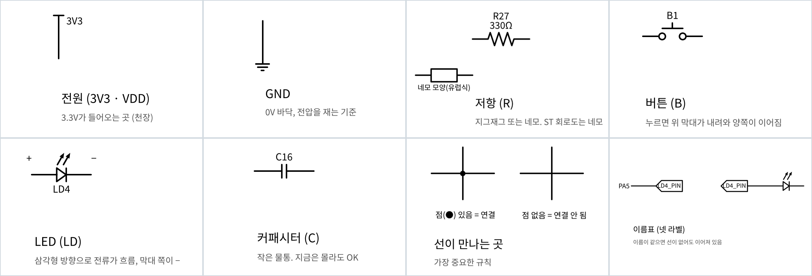
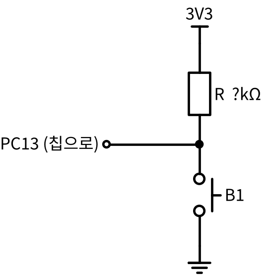

# 기초 03. 회로도 기호 읽기

> 보드 회로도를 읽기 위해 자주 나오는 회로도 기호와 읽는 규칙을 정리하고, 버튼(B1) 회로를 연습 문제로 읽어 본 노트

 

## 📌 회로도란
- 부품을 **기호**로 그리고, 부품끼리 어떻게 **연결**되어 있는지 선으로 나타낸 지도다.
- 회로도에서 중요한 것은 종이 위의 위치(위·아래·앞·뒤)가 아니라 **무엇이 무엇과 연결되어 있는지**다.

 

## 🔣 자주 나오는 기호

| 기호 | 의미 | 보드 이름 |
| --- | --- | :---: |
| 전원 (3V3, VDD) | 3.3V가 들어오는 곳 | - |
| GND | 0V, 전압을 재는 기준 | - |
| 저항 | 지그재그(미국식) 또는 네모(유럽식). ST 회로도는 주로 네모로 그린다 | `R` |
| 버튼 | 누르면 막대가 내려와 양쪽이 이어진다 | `B` |
| LED | 삼각형이 가리키는 방향으로 전류가 흐르고, 막대 쪽이 −(캐소드) | `LD` |
| 커패시터 | 전기를 잠깐 담아 두는 부품 (이후에 학습) | `C` |
| 칩 | 큰 네모와 핀 이름. 칩 내부는 그리지 않는다 | `U` |

 

## 📏 읽는 규칙
1. **점(●)이 있어야 연결된 것**이다. 점 없이 선이 겹치기만 하면 연결되지 않은 것이다.
2. **이름표(넷 라벨)가 같으면 연결된 것**이다. 회로도가 복잡할 때 선을 끝까지 그리지 않고 같은 이름표를 붙인다.
3. **부품 이름 = 보드에 인쇄된 글씨**다. 회로도의 `R27`, `B1`, `LD4`, `C16`은 보드 위 같은 글씨 옆의 부품이다. 그래서 회로도에서 찾은 부품을 보드에서도 바로 찾을 수 있다.

 

## 🧪 연습 문제: 버튼 회로 읽기

| 질문 | 답 |
| --- | --- |
| 버튼을 안 누르면 PC13은 저항을 거쳐 어디와 연결되어 있나? | **3V3** |
| B1을 누르면 PC13은 어디와 바로 연결되나? | **GND** |
| 풀업인가, 풀다운인가? | **풀업** (저항의 반대쪽 끝이 3V3에 연결) |
| 어디서 본 회로인가? | [버튼 실습](../../01_gpio/02_button_led)의 **B1 회로**이며, [플로팅 실험](../../00_basics/02_floating_input)의 **실험 D(풀업 + GND 선)** 와 같은 구조 |

### 플로팅 실험 D와 비교
| | 플로팅 실험 D (PA0) | 버튼 회로 (B1, PC13) |
| --- | --- | --- |
| 풀업 저항 위치 | **칩 안** (PUPDR로 연결) | **보드 위** (납땜된 부품) |
| 핀을 GND에 잇는 것 | 점퍼선을 꽂았다 뺐다 | 버튼을 눌렀다 뗐다 |
| 결과 | 꽂으면 0 | 누르면 0 |

- 버튼은 **핀과 GND 사이의 연결을 켰다 껐다 하는 스위치**다. 점퍼선을 꽂았다 빼는 일을 버튼이 대신한다.

 

## 🔍 헷갈렸던 점

### 1. "저항이 위에 있으니까 풀업이다"
- **처음 생각**: 회로도에서 저항이 위쪽에 그려져 있어서 풀업이다.
- **실제로는**: 회로도는 그리는 사람에 따라 위아래를 바꿔 그릴 수 있다. 풀업인 이유는 저항이 위에 있어서가 아니라 **저항의 반대쪽 끝이 3V3에 연결**되어 있어서다.
- **기억할 한 문장**: 종이 위 위치가 아니라 연결된 곳을 본다.

### 2. "이 회로는 PA0 실험에서 GND 쪽에 저항이 있던 것과 비슷하다"
- **처음 생각**: PA0 실험과 비슷한데, 그때는 GND 쪽에 저항이 있었고 이번에는 버튼이 있다.
- **실제로는**: GND 쪽에 저항이 있던 것은 **실험 C(풀다운)** 이고, 이 회로와는 반대다. 이 회로와 같은 것은 **실험 D(풀업 + 점퍼선으로 GND 연결)** 이며, 점퍼선 자리에 버튼이 들어간 것이다.
- **기억할 한 문장**: B1 회로 = 풀업 + 버튼으로 GND 연결 = 실험 D.

 

## 📝 공부 방법
- 기호는 한 번에 외우기보다, 회로도를 자주 보면서 위 표를 참고해 자연스럽게 익히기로 했다.

 

## ➡️ 다음
- [[기초 04] 보드 회로도 확인](./04_board_schematic.md) — NUCLEO-C031C6 회로도(MB1717)에서 B1의 풀업 저항(`R29`)과 LD4의 저항(`R27`)을 직접 찾아 연습 문제와 비교하기
