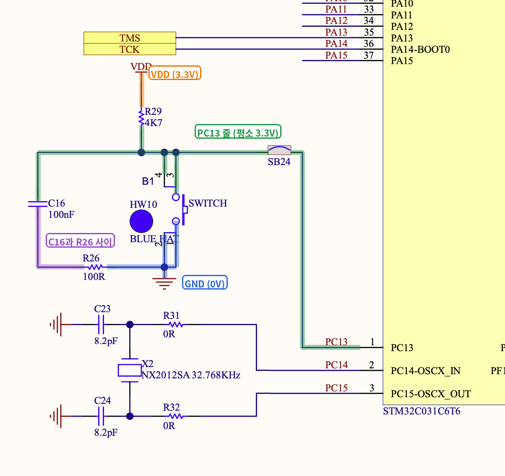
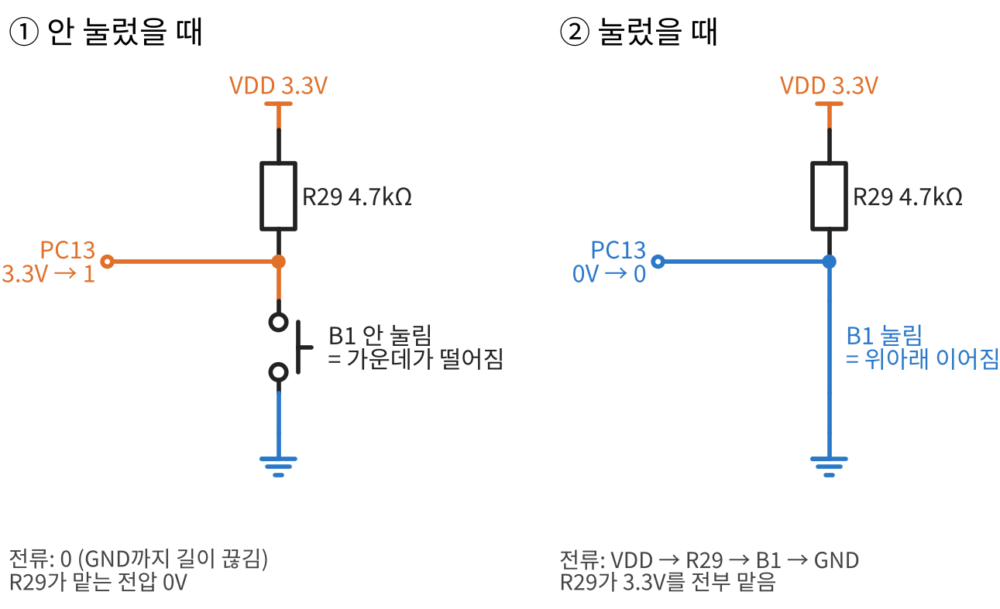
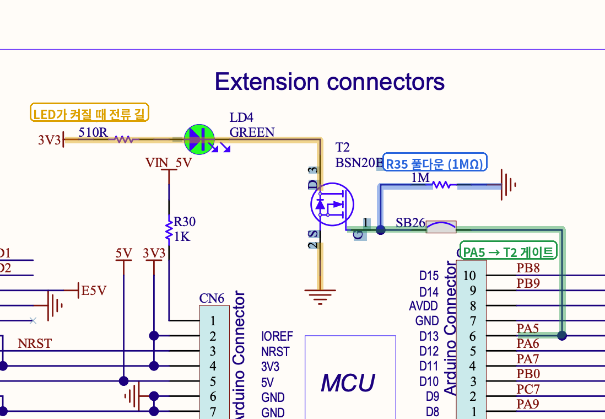

# 기초 04. 보드 회로도 확인

> NUCLEO-C031C6의 실제 회로도(MB1717)에서 버튼 B1과 LED LD4 회로를 직접 찾아, 기초 03의 연습 문제와 비교하고 코드가 왜 그렇게 동작했는지 회로로 확인한 노트

 

## 📌 회로도 찾기

| 항목 | 내용 |
| --- | --- |
| 문서 | NUCLEO-C031C6 보드 회로도 [MB1717](https://www.st.com.cn/resource/en/schematic_pack/mb1717-c031c6-b02_schematic.pdf) |
| B1 회로 | 3쪽 **STM32 microcontroller IOs** |
| LD4 회로 | 4쪽 **Connectors** (Extension connectors) |
| 함께 본 문서 | 보드 사용자 매뉴얼 [UM2953](https://www.st.com/resource/en/user_manual/um2953-stm32c0-nucleo64-board-mb1717-stmicroelectronics.pdf) |

- 회로도는 여러 쪽으로 나뉘어 있어, 부품 이름(`B1`, `LD4`)이나 핀 이름(`PC13`, `PA5`)으로 검색해서 찾았다.

 

## 🔤 새로 나온 표기

### 부품 값 읽기
| 표기 | 읽는 법 | 값 |
| --- | --- | --- |
| `4K7` | 4.7 킬로옴 | 4,700Ω (소수점 자리에 단위를 쓴다) |
| `100R` | 100 옴 | 100Ω (`R` = 옴) |
| `510R` | 510 옴 | 510Ω |
| `1K` | 1 킬로옴 | 1,000Ω |
| `1M` | 1 메가옴 | 1,000,000Ω |
| `100nF` | 100 나노패럿 | 0.1uF (커패시터 값) |

### 단위 앞 글자 (1000배씩)
| p | n | u (=μ) | m | (기본) | k | M |
| :---: | :---: | :---: | :---: | :---: | :---: | :---: |
| 피코 | 나노 | 마이크로 | 밀리 | - | 킬로 | 메가 |

- 한 칸 오른쪽으로 갈 때마다 1000배 커진다. 그래서 `100nF` = `0.1uF`이다.
- 회로도에서는 `μ` 대신 키보드로 치기 쉬운 `u`를 자주 쓴다.

### 그 밖의 표기
| 표기 | 의미 | 이번에 본 예 |
| --- | --- | --- |
| `SB` | **솔더 브리지**. 납땜으로 이어 붙이거나 떼어서 연결을 켜고 끄는 자리 | `SB24` (B1 ↔ PC13), `SB26` (PA5 ↔ T2) |
| `ON` / `OFF` | 솔더 브리지가 기본으로 이어져(ON) 있는지, 끊겨(OFF) 있는지 | |
| `DNF` | Do Not Fit. 회로도에는 있지만 **실제로는 납땜하지 않은** 부품 | |
| `AGND` / `AVDD` | 아날로그 회로용 GND / 전원 (잡음을 줄이려고 따로 표시) | |
| `HW` | 전기 부품이 아닌 **물건**(나사, 캡 등) | `BLUE HAT` = B1의 파란 캡, `BLACK HAT` = B2(리셋)의 검은 캡 |

### 부품 이름 앞 글자
| 글자 | 부품 | 글자 | 부품 |
| :---: | --- | :---: | --- |
| `R` | 저항 | `U` | 칩 |
| `C` | 커패시터 | `D` | 다이오드 |
| `LD` | LED | `X` | 크리스털(시계 부품) |
| `B` | 버튼 | `CN` | 커넥터 |
| `T` | 트랜지스터 | `JP` | 점퍼 |
| `SB` | 솔더 브리지 | `TP` | 테스트 포인트 |

 

## 🔘 B1 회로

| 찾은 것 | 연결 |
| --- | --- |
| 풀업 저항 | **`R29` (4K7)** — 한쪽은 **VDD**, 다른 쪽은 **PC13 넷** |
| 버튼 | **`B1`** — 3·4번 다리는 **PC13 넷**, 1·2번 다리는 **GND** |
| 칩과의 연결 | PC13 넷이 **`SB24`** 를 거쳐 칩의 PC13 핀으로 |
| 추가 부품 | **`C16` (100nF)** 과 **`R26` (100R)** — `PC13 넷 – C16 – R26 – GND` 순서로 이어짐 |

- 기초 03의 연습 문제(`3V3 – 저항 – PC13 – 버튼 – GND`)와 **같은 풀업 구조**다. 실제 보드에는 C16·R26이 더 붙어 있다.
- C16·R26은 버튼을 누를 때 생기는 **떨림을 부드럽게** 해 주는 부품이다. 다음 실습(디바운싱)에서 자세히 다룬다.
- 부품은 늘 **두 넷 사이**에 끼어 있다. 부품의 한쪽 다리가 어디에 연결됐는지 봤다면, **다른 쪽 다리**가 어디에 연결됐는지도 함께 봐야 한다.

### 버튼을 누르기 전과 후

| | 안 눌렀을 때 | 눌렀을 때 |
| --- | --- | --- |
| B1 | 틈이 벌어져 있음 | 틈이 닫혀 PC13 넷과 GND가 이어짐 |
| 전류 | 흐르지 않음 (0) | `VDD → R29 → B1 → GND` |
| R29가 맡는 전압 | 0 × 4.7kΩ = **0V** | **3.3V 전부** |
| PC13 넷 전압 | **3.3V** | **0V** |
| 칩이 읽는 값 | **1** | **0** |

- 그래서 B1은 **누르면 0**이 되는 액티브 로우이고, [버튼 실습](../../01_gpio/02_button_led)에서 `B1_PRESSED`를 `GPIO_PIN_RESET`으로 정의한 이유가 이 회로에 있다.
- 보드 위에 R29라는 풀업 저항이 이미 있으므로, 칩 안의 풀업은 켤 필요가 없어 CubeMX에서 **No pull**로 두었다.

 

## 💡 LD4 회로

| 찾은 것 | 연결 |
| --- | --- |
| LED 전류 길 | **3V3 → `R27` (510R) → `LD4` (초록 LED) → `T2` → GND** |
| 트랜지스터 | **`T2` (BSN20BK)** — 드레인은 LD4, 소스는 GND, 게이트는 `SB26`을 거쳐 **PA5** |
| 게이트 풀다운 | **`R35` (1MΩ)** — T2의 게이트와 GND 사이 |

### 트랜지스터 = 전기로 누르는 버튼
| PA5 | T2 | LD4 |
| :---: | --- | :---: |
| **1** (전압 높음) | 게이트가 눌려 드레인–소스가 이어짐 → LED 길이 GND까지 연결 | **켜짐** |
| **0** (전압 낮음) | 드레인–소스가 끊김 → 전류가 흐를 길이 없음 | **꺼짐** |

- PA5는 LED에 직접 전류를 보내는 것이 아니라, **T2라는 버튼을 전기로 눌렀다 뗐다** 하는 역할만 한다. LED에 흐르는 전류는 3V3에서 온다.
- 트랜지스터를 쓰는 이유: 이 보드는 칩을 **1.8V**로도 동작시킬 수 있게 만들어져 있어(UM2953), 칩 핀의 전압만으로는 LED를 확실히 켜지 못할 수 있다. 그래서 LED는 3V3에서 전기를 받고, 칩은 T2만 조절한다.
- **R35는 실제 보드에 쓰인 풀다운**이다. PA5가 아직 설정되지 않아 플로팅일 때(전원을 켠 직후 등)에도 게이트를 GND 쪽에 연결해 두어 LED가 제멋대로 켜지지 않게 한다. [기초 02](./02_digital_floating.md)에서 칩 안에서 실험한 풀다운을 보드 위에서 다시 만났다.
- R27(510Ω)은 [기초 01](./01_voltage_current_resistance.md)에서 배운 **LED 전류를 줄여 주는 저항**이다.

 

## 💡 정리
- 회로도에서 부품을 찾으면 **양쪽 다리가 각각 어느 넷에 연결됐는지**를 본다. 위·아래나 앞·뒤 위치는 상관없다.
- **B1** = 보드 위 풀업(R29) + 버튼으로 GND 연결 → 평소 1, 누르면 0 (액티브 로우).
- **LD4** = 3V3에서 R27과 LD4를 지나 T2로 가는 길을, PA5가 T2를 눌러 열고 닫는다 → PA5 = 1이면 켜짐.
- 코드에서 정한 값(`GPIO_PIN_RESET`이 눌림, `GPIO_PIN_SET`이 LED 켜짐)의 이유는 모두 **보드 회로도**에 있다.

 

## 🔍 헷갈렸던 점

### 1. "B1의 다른 쪽도 VDD에 연결되어 있다"
- **처음 생각**: B1의 한쪽이 R29를 거쳐 VDD에 이어져 있으니, 다른 쪽도 VDD 쪽이다.
- **실제로는**: B1의 3·4번 다리는 PC13 넷(R29를 거쳐 VDD)에, **1·2번 다리는 GND**에 연결되어 있다. 그래서 누르면 PC13 넷이 GND에 이어져 0이 된다.
- **기억할 한 문장**: 버튼은 PC13 넷과 GND 사이에 있는 스위치다.

### 2. "C16은 VDD 쪽, R26은 GND 쪽에 있다"
- **처음 생각**: C16과 R26이 각각 VDD와 GND에 붙어 있다.
- **실제로는**: 두 부품은 `PC13 넷 – C16 – R26 – GND` 순서로 이어져 있다. C16의 한쪽은 PC13 넷, 다른 쪽은 R26과 만나는 넷이고, R26의 다른 쪽이 GND다.
- **기억할 한 문장**: 부품은 늘 두 넷 사이에 끼어 있다.

### 3. "스위치가 1이라는 값을 가진다"
- **처음 생각**: 버튼(스위치) 자체가 0이나 1의 값을 가진다.
- **실제로는**: 버튼은 **틈이 열리고 닫히는 연결**일 뿐이고, 0/1은 **PC13 넷의 전압**을 칩이 읽고 내린 판단이다. 안 누르면 틈이 열려 PC13 넷이 3.3V(1), 누르면 GND와 이어져 0V(0)가 된다.
- **기억할 한 문장**: 값은 스위치가 아니라 넷이 갖는다.

### 4. "다른 쪽 = 방향(오른쪽·아래쪽)"
- **처음 생각**: "반대쪽"이라는 말을 회로도 위의 방향으로 이해했다.
- **실제로는**: 줄(넷)과 연결된 다리의 **다른 쪽 다리**를 뜻한다. 저항이나 버튼은 다리가 둘이라, 한쪽 다리를 따라갔으면 나머지 다리가 다른 쪽이다.
- **기억할 한 문장**: 방향이 아니라 부품의 나머지 다리.

### 5. "트랜지스터가 0/1을 만든다"
- **처음 생각**: LED 신호가 T2를 거치면서 T2가 0이나 1을 만든다.
- **실제로는**: 0/1은 PA5가 내보내고, T2는 그 전압에 눌려 **LED 전류 길을 열고 닫는 버튼** 역할을 한다.
- **기억할 한 문장**: 트랜지스터는 전기로 누르는 버튼.

 

## 🧪 확인
- **미션 1 (B1)**: 회로도 3쪽에서 R29(4K7) 풀업, B1, SB24, C16(100nF), R26(100R)을 찾아 각 부품의 양쪽 다리가 어느 넷에 연결됐는지 확인했다.
- **미션 2 (LD4)**: 회로도 4쪽에서 R27(510R), LD4, T2(BSN20BK), SB26, R35(1MΩ)를 찾아 LED 전류 길과 PA5가 T2를 조절하는 길을 확인했다.
- 회로도에서 찾은 내용이 [버튼 실습](../../01_gpio/02_button_led)(누르면 0)과 [LED 실습](../../01_gpio/01_led_blink)(PA5 = 1이면 켜짐)의 결과와 맞는 것을 확인했다.

 

## ➡️ 다음
- [GPIO] 버튼 토글 & 디바운싱 — 버튼을 한 번 누를 때마다 LED를 켰다 껐다 하고, 버튼의 떨림을 코드로 걸러 내기 (이번에 본 C16·R26과 연결)
